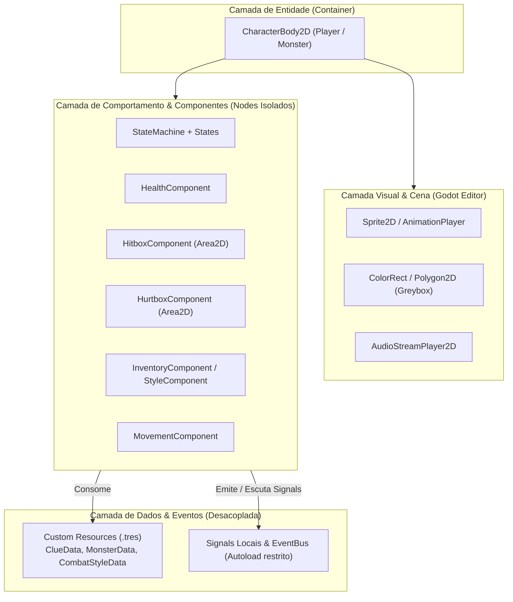

<!--
SYNC IMPACT REPORT
==================
Version change: 1.0.0 → 1.1.0
Bump rationale: Integração oficial com GitHub Spec Kit (.specify/ + .agents/skills/speckit-*),
  consolidando a árvore de artefatos por feature em specs/[###-feature-name]/ e mantendo os
  dois Portões de Qualidade (Clarificação e Análise) verificados pessoalmente pelo Desenvolvedor.

Principles defined:
  I.   Padrão de Código, Arquitetura Modular e Camadas (Godot 4.x Anti-AI Slop)
  II.  Política de Testes, Cobertura Mínima e Placeholder First (Greyboxing)
  III. Requisitos de Segurança, Integridade e Tratamento de Dados
  IV.  Convenções de Nomenclatura, Commits e Estrutura Oficial de Pastas

Templates reviewed for alignment:
  ✅ .specify/templates/overrides/spec-template.md — Inclui Histórias Priorizadas, Requisitos Numerados,
       Casos de Borda, Fora do Escopo (Non-Goals) e Portão de Qualidade 1 (Clarificação).
  ✅ .specify/templates/overrides/plan-template.md — Inclui Arquitetura Godot 4.x (Nodes/Components,
       StateMachine, Signals, @export Game Feel, Custom Resources) e Constitution Check automático.
  ✅ .specify/templates/overrides/tasks-template.md — Inclui Tarefas Ordenadas com DoD, Dependências,
       Vínculo com Issues e Portão de Qualidade 2 (Análise Cruzada e Checklist por Tipo de Risco).
  ✅ .specify/templates/overrides/checklist-template.md — Checklist de qualidade de requisitos em PT-BR.
-->

# 📜 CONSTITUIÇÃO DO PROJETO HUNTRESS (v1.1.0)

> **Etapa do Ciclo SDD:** `1. Constituição` (`/speckit-constitution`)  
> **Engine & Linguagem:** Godot 4.x | GDScript Estrito (Tipagem Estática)  
> **Localização Canônica Spec Kit:** `.specify/memory/constitution.md` (espelhada em `docs/CONSTITUICAO.md`)  
> **Propósito:** Definir as leis imutáveis de arquitetura, qualidade, testes, segurança de dados e organização do repositório. Nenhum Plano, Especificação, Tarefa ou linha de código pode contrariar este documento.

---

## 1. Padrão de Código, Arquitetura e Camadas

### 1.1. Filosofia Anti-AI Slop e Modularidade Total
- **Proibição de Scripts Monolíticos:** Nenhum script `.gd` deve acumular múltiplas responsabilidades (ex.: um `player.gd` que controla input, física, cálculo de dano, UI de vida, inventário e áudio ao mesmo tempo é **estritamente proibido**).
- **Limite de Complexidade:** Scripts que ultrapassem **200–250 linhas** ou funções que ultrapassem **30 linhas** devem ser refatorados em Componentes (`Node`) ou classes auxiliares.
- **Responsabilidade Única (SRP):** Cada Node ou Script deve responder a uma única razão para mudar.

### 1.2. Arquitetura em Camadas e Padrões de Projeto (Godot 4.x)



1. **Component Pattern Obrigatório:**
   - Atributos e comportamentos compartilháveis devem ser implementados como cenas/nós independentes e reutilizáveis por qualquer entidade (Player, Monstros Menores, Bosses, Objetos Destrutíveis):
     - `HealthComponent` (`Node`): Gerencia HP atual, HP máximo, invencibilidade temporária e emite sinais `damaged`, `healed`, `died`.
     - `HitboxComponent` (`Area2D`): Causa dano; carrega um payload de ataque (`AttackData`) incluindo tipo de dano, elemento/óleo aplicado e força de *knockback*.
     - `HurtboxComponent` (`Area2D`): Detecta `HitboxComponent`, aplica multiplicadores de fraqueza/resistência (essencial para a mecânica estilo *The Witcher*) e repassa ao `HealthComponent`.
     - `VelocityComponent` / `MovementComponent` (`Node`): Encapsula aceleração, atrito (*friction*), velocidade máxima e aplicação de *knockback* em `CharacterBody2D`.
     - `InventoryComponent` & `GrimoireComponent`: Gerenciam itens de preparo e pistas coletadas orientados a `Custom Resources`.
2. **Máquina de Estados Finita (`StateMachine`) Isolada:**
   - O Player e os inimigos/Bosses devem utilizar uma `StateMachine` baseada em Nodes (`StateMachine` $\rightarrow$ nós filhos `State`, como `IdleState`, `MoveState`, `AttackState`, `DodgeState`, `StaggerState`).
   - Cada estado contém apenas sua própria lógica de `enter()`, `exit()`, `update(delta)` e `physics_update(delta)`, solicitando transições via sinal `transition_requested(from_state, to_state_name)`.
3. **Comunicação Desacoplada (Signals First):**
   - **Regra *Call Down, Signal Up*:** Um nó pai pode chamar métodos públicos de seus filhos diretos (ou referências injetadas via `@export`), mas um nó filho **nunca** deve usar `get_parent().get_parent()` ou caminhos relativos frágeis (`get_node("../../UI")`). Filhos se comunicam para cima ou para o mundo exclusivamente via `signal`.
   - **Comunicação entre Sistemas Distantes:** Para eventos globais desacoplados (ex.: *Coletar Pista no Mapa* $\rightarrow$ *Atualizar Grimório* $\rightarrow$ *Notificar HUD*), utiliza-se um `SignalBus` / `EventBus` enxuto (Autoload) contendo **apenas declarações de sinais**, sem estado ou lógica acoplada.
4. **Game Feel 100% Parametrizado (`@export`):**
   - **Proibido o uso de "Números Mágicos" (Magic Numbers)** hardcoded na física ou no combate.
   - Variáveis de *Game Feel* — como `max_speed`, `acceleration`, `friction`, `dodge_duration`, `dodge_speed_curve`, `knockback_force`, `hitstop_duration`, `screen_shake_intensity` — **devem obrigatoriamente usar `@export`** (preferencialmente agrupadas com `@export_group` e `@export_range`) para ajuste fino manual direto no Inspector da Godot.
5. **Tipagem Estática Estrita em GDScript:**
   - Todo script deve utilizar tipagem estática explícita em variáveis, parâmetros de função e tipos de retorno:
     ```gdscript
     @export var max_health: float = 100.0
     var _current_health: float = 0.0

     func apply_damage(amount: float, element: CombatTypes.Element) -> void:
     ```
   - Os avisos de `untyped_declaration` e `inferred_declaration` devem ser tratados como erro nas configurações do projeto Godot.

---

## 2. Política de Testes e Cobertura Mínima

### 2.1. Abordagem *Placeholder First* (Greyboxing Obrigatório)
- **Regra de Ouro Visual:** Nenhuma mecânica de gameplay (movimentação, esquiva, hitbox/hurtbox, coleta de pista, IA de Boss) pode depender de sprites finais, animações complexas de Pixel Art ou tilesets decorados para ser construída e validada.
- Toda funcionalidade deve nascer e ser validada em **Greybox** (`ColorRect`, `Polygon2D`, `CollisionShape2D` visíveis com cores semânticas: ex. Verde = Player, Azul = Esquiva/Invulnerável, Amarelo = Pista Interagível, Vermelho = Hitbox ativa).

### 2.2. Testes Automatizados (GdUnit4 / GUT) e Cobertura por Camada
Para garantir que mudanças futuras não quebrem o sistema tático de caça e combate, adotamos três níveis de verificação:

| Camada | Tipo de Teste | Cobertura Mínima Exigida | O que deve ser testado obrigatoriamente |
| :--- | :--- | :---: | :--- |
| **Camada de Dados & Cálculo (`Resources`, Fórmulas de Dano/Fraqueza, Grimório)** | Testes Unitários Automatizados | **$\ge$ 90%** | Cálculo de dano com fraquezas/resistências elementais, desbloqueio de informações no Grimório ao somar pistas, adição/consumo de ferramentas no inventário. |
| **Camada de Componentes & StateMachine (`HealthComponent`, `HurtboxComponent`, `StateMachine`)** | Testes de Componente (Cena Isolada) | **$\ge$ 80%** | Emissão correta de sinais (`died`, `damaged`), frames de invencibilidade, transições válidas e inválidas de estados, resistência a estados nulos. |
| **Camada de Gameplay & Cenas (`Player`, `Boss`, `InvestigationRoom`)** | Cena de Teste Greybox (*Sandbox Scene*) + Checklist Manual | **100% dos Requisitos Funcionais (`RF-XXX`) da Spec** | Cada feature deve ter ou atualizar uma cena de validação rápida em `res://tests/sandboxes/` permitindo testar todos os casos de borda da Spec em menos de 30 segundos. |

---

## 3. Requisitos de Segurança e Tratamento de Dados

Mesmo sendo um RPG single-player offline, a segurança e a integridade de dados são críticas para evitar corrupção de progresso e vulnerabilidades de deserialização na Godot:

1. **Proibição de Deserialização Insegura em Saves:**
   - Arquivos de progresso do jogador (`user://saves/`) **NUNCA** devem usar `ResourceLoader.load()` em arquivos `.tres` gravados na pasta `user://` sem bloqueio de scripts, pois arquivos `.tres` na Godot podem conter `GDScript` embutido malicioso (vetor conhecido de *Arbitrary Code Execution* em jogos Godot).
   - **Padrão Oficial de Save:** O progresso do jogador (contratos concluídos, pistas descobertas, upgrades da vila, inventário) deve ser serializado em **JSON estruturado e validado por schema** (ou binário puro via `FileAccess.store_var(..., false)` com `allow_objects = false`), salvando apenas IDs estáticos e valores primitivos.
2. **Imutabilidade de Dados Base (Catálogo vs. Instância):**
   - `Custom Resources` de catálogo em `res://src/data/` (ex.: dados base de um monstro ou de uma pista) devem ser tratados como **somente leitura** em tempo de execução, ou duplicados (`resource.duplicate()`) quando precisarem sofrer mutação local, evitando que o estado de uma luta contamine o recurso original em memória.
3. **Validação Defensiva e Fail-Safe:**
   - Todo componente deve validar se suas dependências obrigatórias (`@export var health_component: HealthComponent`) foram configuradas, utilizando `_get_configuration_warnings()` para alertar no próprio editor da Godot e `assert()` em modo debug.
   - Dados carregados de arquivos externos devem passar por sanitização de limites (`clampf`, `clampi`, verificação de chaves existentes e fallback seguro) para impedir *crashes* por save corrompido.

---

## 4. Convenções de Nome, Commits e Estrutura de Pastas

### 4.1. Convenções de Nomenclatura (Godot 4 Official Style Guide)

| Elemento | Convenção | Exemplo |
| :--- | :--- | :--- |
| **Pastas e Arquivos (`.gd`, `.tscn`, `.tres`, `.png`)** | `snake_case` | `health_component.gd`, `blood_trail_clue.tres` |
| **Classes (`class_name`) e Nós na Árvore de Cena** | `PascalCase` | `class_name HealthComponent`, nó `HurtboxComponent` |
| **Funções, Métodos e Variáveis Locais/Exportadas** | `snake_case` | `func apply_knockback()`, `@export var max_speed: float` |
| **Variáveis e Métodos Privados/Internos** | `_snake_case` (prefixo `_`) | `var _is_invulnerable: bool = false` |
| **Sinais (`signal`)** | `snake_case` no **passado** (ou evento claro) | `signal clue_collected(clue_id: StringName)`, `signal health_depleted` |
| **Constantes e Valores de `enum`** | `CONSTANT_CASE` (Enums em `PascalCase`) | `const MAX_CLUES: int = 5`, `enum State { IDLE, MOVING, DODGING }` |

### 4.2. Estrutura Oficial de Pastas do Repositório (Spec Kit + Godot 4.x)

```text
huntress/
├── AGENTS.md                  # Regras sempre ativas do agente Antigravity (Governança SDD)
├── README.md                  # Visão geral do projeto e índice rápido
├── project.godot              # Arquivo raiz do projeto Godot 4.x (quando inicializado)
├── .agents/
│   └── skills/                # Skills nativas do Spec Kit para o Antigravity (/speckit-*)
├── .specify/                  # Motor oficial do GitHub Spec Kit
│   ├── memory/
│   │   └── constitution.md    # Constituição ativa lida automaticamente pelo Spec Kit
│   ├── scripts/
│   │   └── powershell/        # Scripts de automação e validação SDD (Windows PowerShell)
│   ├── templates/             # Templates base do Spec Kit + pasta overrides/ customizada
│   │   └── overrides/         # Templates PT-BR adaptados para Godot 4.x e Portões 1 e 2
│   └── extensions/            # Extensões oficiais instaladas (github, assess, bug)
├── specs/                     # Artefatos SDD agrupados por Feature (Padrão Oficial Spec Kit)
│   └── NNN-nome-feature/      # Ex.: 001-movimentacao-cacadora/
│       ├── spec.md            # Etapa 2 & 3: Especificação + Clarificação (🔒 Portão 1)
│       ├── plan.md            # Etapa 4: Plano Técnico + Constitution Check
│       ├── tasks.md           # Etapa 5 & 6: Tarefas + Análise Cruzada (🔒 Portão 2)
│       ├── research.md        # Pesquisas técnicas/design da feature (opcional)
│       ├── data-model.md      # Modelo de Resources/Sinais da feature (opcional)
│       └── checklists/        # Checklists de validação de requisitos (requirements.md)
├── docs/                      # Documentação Estratégica e de Processo do Jogo
│   ├── CONSTITUICAO.md        # Espelho de leitura rápida da Constituição
│   ├── SDD_WORKFLOW.md        # Regras do fluxo SDD, comandos Spec Kit e Portões de Qualidade
│   ├── GDD.md                 # Game Design Document (Conceito, Core Loop, Mecânicas)
│   └── inspirations/          # Análises de jogos referência (CrossCode, The Witcher, etc.)
├── src/                       # Código-fonte e Cenas de Produção (Godot)
│   ├── core/                  # Autoloads restritos (SignalBus, SaveManager, GameTypes)
│   ├── components/            # Componentes modulares reutilizáveis (Health, Hitbox, Hurtbox, Movement...)
│   ├── state_machine/         # Base da StateMachine reutilizável
│   ├── entities/              # Entidades completas montadas por composição
│   │   ├── player/            # Cena da Caçadora, estados específicos e controlador de input
│   │   ├── monsters/          # Inimigos menores e Bosses
│   │   └── interactables/     # Pistas físicas, armadilhas, objetos de cenário
│   ├── systems/               # Sistemas de domínio (Grimório, Investigação, Preparação, Contratos)
│   ├── data/                  # Definições de classes Resource (.gd) e catálogo de dados (.tres)
│   ├── ui/                    # HUD, Grimório UI, Menus
│   └── world/                 # Níveis, salas de investigação, vila e covis
├── assets/                    # Recursos visuais e sonoros (aplicados APÓS o greyboxing)
│   ├── sprites/
│   ├── audio/
│   └── fonts/
└── tests/                     # Suíte de testes e validação
    ├── unit/                  # Testes automatizados de dados, recursos e componentes
    └── sandboxes/             # Cenas Greybox para teste isolado de mecânicas
```

### 4.3. Padrão de Commits e Issues (Conventional Commits)
Todos os commits devem ser atômicos, seguindo o formato:

```text
<tipo>(<escopo>): <descrição curta no imperativo> (#<id-da-issue>)
```

- **Tipos permitidos:** `docs`, `feat`, `fix`, `refactor`, `test`, `chore`.
- **Exemplos:**
  - `docs(sdd): integra github spec-kit com overrides para Godot 4.x`
  - `docs(spec): adiciona especificacao 001 de movimentacao pos-clarificacao`
  - `feat(components): implementa HealthComponent e HurtboxComponent isolados (#3)`

**Version**: 1.1.0 | **Ratified**: 2026-10-20 | **Last Amended**: 2026-10-20
