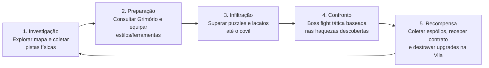

# 🎮 GAME DESIGN DOCUMENT (GDD) — PROJETO HUNTRESS

> **Documento Vivo:** Este GDD consolida a visão criativa, o Core Loop, os pilares de design e o banco de referências do **Projeto Huntress**. Cada mecânica aqui descrita deve ser detalhada individualmente em `docs/specs/` seguindo o fluxo SDD antes de ser implementada.

---

## 1. Visão Geral do Jogo

| Atributo | Definição |
| :--- | :--- |
| **Título de Trabalho** | **Projeto Huntress** |
| **Gênero** | Action RPG Tático de Caça a Monstros |
| **Perspectiva & Arte** | 2D Top-Down / Isométrico em Pixel Art |
| **Referência Visual & Fluidez** | *CrossCode* (Radical Fish Games) |
| **Referência de Core Loop & Fantasia** | *The Witcher 3: Wild Hunt* + *Monster Hunter* |
| **Engine & Linguagem** | Godot 4.x (GDScript estrito) |

### 1.1. Fantasia Central (Player Fantasy)
Você não é um herói imortal que vence monstros apenas apertando o botão de ataque repetidamente (*button mashing*). Você é uma **Caçadora profissional**: letal quando preparada, vulnerável quando imprudente.  
Conhecimento é sua maior arma — observar uma pegada profunda na lama, identificar um resíduo ácido nas árvores ou ouvir relatos na vila determina qual postura de luta, óleo ou ferramenta será a diferença entre uma execução cirúrgica e a morte no covil.

---

## 2. Pilares de Design

1. **Conhecimento = Poder Real em Combate (Tactical Hunting):**
   - Pistas coletadas não são meros colecionáveis de texto (*lore*). Cada pista revela um comportamento concreto do monstro (padrão de investida, ponto cego, vulnerabilidade elemental ou janela de atordoamento) e habilita contramedidas práticas no preparo.
2. **Fluidez Responsiva de Combate 2D (*CrossCode Feel*):**
   - Movimentação em 8 direções (ou 360°), esquiva (*dash*) ágil, ataques com resposta tátil imediata (*hitstop*, *knockback*, *screen shake* parametrizados) e troca fluida de postura/estilo.
3. **Bosses Punitivos, Porém Justos:**
   - Lutar às cegas contra um monstro deve ser altamente punitivo (dano reduzido, armadura ativa ou ataques difíceis de interromper). Lutar com a preparação correta recompensa o jogador com quebras de postura (*stagger*), dano amplificado e controle da arena.
4. **Engenharia Modular e *Greybox First*:**
   - Uma mecânica só é considerada divertida se funcionar com retângulos coloridos antes de receber qualquer sprite de Pixel Art.

---

## 3. Core Loop (Ciclo de Gameplay)

### Detalhamento das Fases do Loop:
1. **Investigação:**
   - A Caçadora explora zonas interconectadas (clareiras, ruínas, cavernas, arredores da vila) examinando vestígios deixados pela criatura: pegadas, carcaças, marcas de garras, secreções ou testemunhos.
2. **Preparação:**
   - Ao inspecionar pistas suficientes, o **Grimório** sintetiza a identidade e as vulnerabilidades do monstro alvo.
   - Em pontos seguros (fogueiras/acampamentos ou antes do covil), o jogador configura sua *Build de Caça*: escolhe **Estilos de Luta** (ex.: Postura Rápida/Corte vs. Postura Pesada/Quebra-Guarda) e **Ferramentas/Óleos** específicos para explorar a fraqueza descoberta.
3. **Infiltração:**
   - O caminho até o covil testa as ferramentas escolhidas em micro-desafios: pequenos puzzles ambientais (ex.: queimar teias densas, usar isca ou iluminação) e escaramuças contra monstros menores que introduzem parte da linguagem visual dos ataques do Boss.
4. **Confronto:**
   - Luta principal no covil do monstro. O Boss possui fases, estados de fúria e defesas específicas que exigem que o jogador aplique na prática o que leu no Grimório (ex.: usar uma ferramenta específica quando o monstro carrega determinado ataque para causar *Stagger*).
5. **Recompensa:**
   - Coleta de troféu/espólio da criatura + recebimento do pagamento do contrato na Vila, desbloqueando novas receitas alquímicas, melhorias de equipamento e contratos de ameaça superior.

---

## 4. Banco de Inspirações e Referências (Análise Aplicada)

Para orientar nossas Especificações futuras, extraímos de cada jogo referência exatamente **o que absorver** e **o que evitar** para o escopo indie solo/enxuto:

### 4.1. *CrossCode* (Radical Fish Games)
- **O que absorver:**
  - **Sensação de movimento e combate 2D:** Aceleração quase instantânea com leve atrito de parada, *dash* cancelando final de animações (*animation cancel*), e leitura cristalina de telegrafia de ataques inimigos no plano 2D.
  - **Puzzles integrados ao kit de combate:** Usar as mesmas ferramentas/elementos de combate para interagir com o cenário na fase de *Infiltração*.
  - **Sistema de *Break / Stagger*:** Inimigos possuem uma janela específica em que ficam vulneráveis após uma ação específica; acertar a contramedida certa enche a barra de *Break*, atordoando o monstro.
- **O que evitar (Alerta de Escopo):**
  - Árvores de habilidades gigantescas com centenas de nós passivos de +1% de status. Em *Huntress*, cada habilidade/ferramenta deve ter impacto tático e comportamental claro.

### 4.2. *The Witcher 3: Wild Hunt* (CD Projekt Red)
- **O que absorver:**
  - **Fantasia de Detetive de Monstros:** A transição de *"O que atacou esta caravana?"* (coletando 3 a 4 pistas ambientais distintas) para *"É um Leshen / Grifo, vulnerável a Fogo e bombas de Estilhaço"*.
  - **Grimório / Bestiário Funcional:** Uma interface direta que não apenas conta uma história, mas lista claramente: **Fraquezas Descobertas** e **Comportamentos Letais**.
- **O que evitar / melhorar:**
  - Em *The Witcher 3*, muitas vezes basta seguir uma linha vermelha brilhante no chão sem pensar. Em *Huntress*, podemos tornar a leitura das pistas mais recompensadora: cada pista encontrada revela uma linha concreta do Grimório (ou até mesmo esconde uma pista opcional que revela como anular o ataque mais forte do Boss!).

### 4.3. *Monster Hunter* (Capcom) & *Unsighted* (Studio Pixel Punk)
- **O que absorver:**
  - **Compromisso nos Golpes e Leitura de *Tells*:** O Boss anuncia seus ataques com sinais visuais e sonoros claros (*telegraphs*) antes do impacto.
  - **Parry / Contramedida de Precisão (*Unsighted*):** Recompensar o tempo de reação e o uso da ferramenta certa no momento em que o monstro executa seu golpe assinatura.

---

## 5. Roadmap Sugerido de Especificações (Fatia Vertical / MVP)

Para construirmos o jogo de forma incremental, sem nos perdermos em escopo infinito, nossa meta inicial é um **Vertical Slice (1 Contrato Completo: 1 Zona de Investigação $\rightarrow$ Grimório/Preparo $\rightarrow$ 1 Covil com 1 Boss)**.

Ordem recomendada de Especificações (`docs/specs/`):
1. **`SPEC-001` — Movimentação Base, Esquiva e StateMachine da Caçadora (Greybox)**
2. **`SPEC-002` — Sistema de Combate Base, Hitbox/Hurtbox e Estilos/Fraquezas (Greybox)**
3. **`SPEC-003` — Sistema de Investigação (Coleta de Pistas) e Grimório Dinâmico**
4. **`SPEC-004` — Sistema de Preparação (Equipar Estilo/Ferramenta contra Fraqueza)**
5. **`SPEC-005` — Primeiro Monstro Alvo (Boss 01): IA, Padrões, Quebra de Postura e Arena**
6. **`SPEC-006` — Loop de Contrato e Recompensa (Início/Fim da Caçada)**
