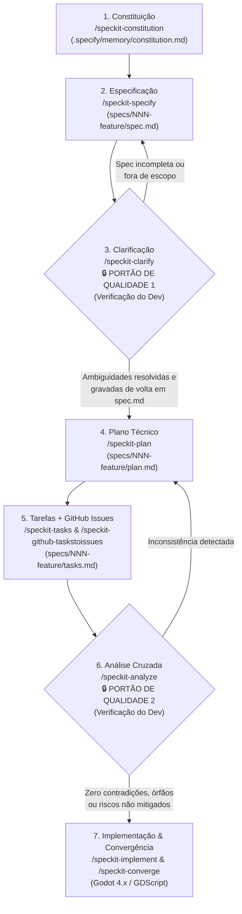

# ⚙️ Escopo e Governança do Ciclo SDD (Spec-Driven Development + GitHub Spec Kit)

> **Projeto:** Huntress (Godot 4.x)  
> **Motor SDD:** [GitHub Spec Kit (`github/spec-kit`)](https://github.com/github/spec-kit) — Integração Nativa Antigravity (`agy` + PowerShell)  
> **Status:** Ativo e Obrigatório  
> **Regra de Ouro:** *Nenhum código de feature é escrito sem antes atravessar a ordem estrita do ciclo SDD e passar pela aprovação humana nos dois Portões de Qualidade.*

---

## 1. Visão Geral do Fluxo, Comandos Spec Kit e Ordem Estrita

Todo ciclo de desenvolvimento no **Projeto Huntress** obedece invariavelmente à seguinte sequência linear, operada através das skills `/speckit-*` em `.agents/skills/` e da estrutura `.specify/`:

---

## 2. Mecanismo Anti-Desvio e Retorno ao Processo (Circuit Breaker)

Seja por pressa, cansaço, preguiça do Desenvolvedor ou tendência da IA de querer pular direto para o código ("atalho agêntico"), **qualquer desvio da ordem estabelecida é bloqueado**.

### Gatilhos de Bloqueio Automático:
1. **Pulo de Etapa:** Tentar iniciar uma etapa $N$ sem que a etapa $N-1$ esteja documentada em `specs/NNN-feature/` e com status `CONCLUÍDA / APROVADA`.
2. **Invasão de Escopo (Scope Creep):** Tentar projetar ou codificar algo listado na seção **Fora do Escopo (Non-Goals)** do arquivo `spec.md`.
3. **Código Prematuro:** Solicitar criação/edição de scripts `.gd` ou cenas `.tscn` antes da aprovação humana no **Portão de Qualidade 2 (Análise — `/speckit-analyze`)**.
4. **Violação Constitucional:** Propor arquitetura que quebre a `.specify/memory/constitution.md` (`docs/CONSTITUICAO.md`) — ex.: scripts monolíticos, acoplamento direto sem `signals`, falta de `@export` para game feel, ausência de greyboxing.

### Protocolo de Correção:
Quando um gatilho é acionado:
1. O trabalho na ação desviada é **interrompido imediatamente**.
2. O agente emite o alerta `🚨 [ALERTA DE GOVERNANÇA SDD]: Desvio de fluxo/escopo detectado.` e aponta em qual etapa do ciclo SDD a feature se encontra atualmente (consultando `.specify/feature.json` e `specs/`).
3. O processo **retorna obrigatoriamente** para a etapa pendente até que seus critérios de saída sejam cumpridos.

---

## 3. Detalhamento das 7 Etapas do Ciclo SDD

### Etapa 1: Constituição (`/speckit-constitution`)
- **Artefato Canônico:** `.specify/memory/constitution.md` (espelhado em `docs/CONSTITUICAO.md`).
- **Escopo:**
  - **Padrão de código, arquitetura e camadas:** Filosofia de Nodes e Component Pattern (`HealthComponent`, `HitboxComponent`, `HurtboxComponent`, `InventoryComponent`), `StateMachine` isolada, comunicação desacoplada via `signals`, tipagem estática estrita em GDScript e parametrização via `@export`.
  - **Política de testes e cobertura mínima:** Abordagem *Placeholder First* (Greyboxing obrigatório antes de arte final), testes automatizados de componentes e máquinas de estado, e cobertura mínima exigida por camada.
  - **Requisitos de segurança e tratamento de dados:** Integridade de arquivos de Save/Load, validação de `Resources` (`.tres`) e dados do Grimório, prevenção de execução de scripts arbitrários em saves.
  - **Convenções de nome, commits e estrutura de pastas:** Guia de estilo oficial da Godot 4.x, árvore de diretórios padronizada (`.specify/`, `specs/`, `docs/`, `src/`, `tests/`) e padrão de *Conventional Commits*.

---

### Etapa 2: Especificação (`/speckit-specify`)
- **Artefato Gerado:** `specs/NNN-nome-da-feature/spec.md` + `specs/NNN-nome-da-feature/checklists/requirements.md` (usando o override `.specify/templates/overrides/spec-template.md`).
- **Escopo:** Define **O QUE** será construído e **POR QUE**, sob a ótica do jogador e do design do jogo:
  - **História de Usuário / Experiência do Jogador e Fluxo Principal:** Narrativa de uso priorizada (`P1`, `P2`...) e passo a passo do fluxo feliz (*Happy Path*).
  - **Requisitos Funcionais Numerados (`RF-001` / `FR-001`, ...):** Declarações claras, testáveis e atômicas de comportamento esperado.
  - **Casos de Borda (`EC-001`, ...) e O Que Dá Errado:** Comportamento esperado em colisões simultâneas, interrupções de estado, entradas inválidas ou limites de recursos.
  - **Fora do Escopo (Non-Goals):** Lista explícita do que **NÃO** será feito nesta especificação (tão importante quanto o que está no escopo).

---

### Etapa 3: Clarificação — 🔒 PORTÃO DE QUALIDADE 1 (`/speckit-clarify`)
- **Verificação Pessoal Obrigatória do Desenvolvedor.**
- **Como funciona:**
  - O agente lê o `spec.md` ativo e aponta o que ficou ambíguo, incompleto ou subespecificado.
  - O agente faz **perguntas fechadas** (uma por vez, com opções de melhoria e recomendação fundamentada), **sempre questionando o porquê** o desenvolvedor está tomando aquela decisão.
  - Cada resposta do desenvolvedor é **gravada de volta no `spec.md`** (na seção `## 6. Clarifications` e atualizando diretamente os `RF-XXX`, `EC-XXX` e `Fora do Escopo`).
- **Critério de Saída do Portão 1:**
  - [ ] Nenhuma pergunta de clarificação permanece aberta.
  - [ ] Todas as respostas foram gravadas de volta no `spec.md` e o checklist `checklists/requirements.md` foi revalidado.
  - [ ] O Desenvolvedor aprovou pessoalmente o Portão 1.

---

### Etapa 4: Plano Técnico (`/speckit-plan`)
- **Artefato Gerado:** `specs/NNN-nome-da-feature/plan.md` (usando o override `.specify/templates/overrides/plan-template.md`).
- **Escopo:** Define **COMO** a Especificação clarificada será arquitetada na Godot 4.x:
  - **Stack e Arquitetura de Nós/Cenas:** Árvore de cenas (`.tscn`), hierarquia de Nodes, componentes reutilizados ou criados e estados da `StateMachine`.
  - **Modelo de Dados e Comunicação:** Definição de `Custom Resources` (`.gd` / `.tres`), estrutura de sinais (`signals`) emitidos e escutados, e variáveis `@export` de *Game Feel*.
  - **Decisões Técnicas com Justificativa (`DT-01`, ...):** Registro das escolhas arquiteturais e seus *trade-offs*.
  - **Constitution Check (Conferência Automática contra a Constituição):** Tabela de auditoria verificando item a item se o Plano respeita 100% da `.specify/memory/constitution.md`.

---

### Etapa 5: Tarefas & Issues (`/speckit-tasks` + `/speckit-github-taskstoissues`)
- **Artefato Gerado:** `specs/NNN-nome-da-feature/tasks.md` (usando o override `.specify/templates/overrides/tasks-template.md`) + Issues no GitHub (`Varto-Kai/huntress`).
- **Escopo:**
  - **Lista Ordenada de Tarefas (`T001`, `T002`, ...):** Organizadas por fase (Setup $\rightarrow$ Fundacional $\rightarrow$ User Stories P1/P2 $\rightarrow$ Polimento).
  - **Critério de Conclusão Claro (Definition of Done - DoD):** Como provar objetivamente que cada tarefa terminou.
  - **Dependências Explícitas:** Quais tarefas bloqueiam cada item e quais podem rodar em paralelo (`[P]`).
  - **Distribuição em Issues:** Execução de `/speckit-github-taskstoissues` para criar/sincronizar as tarefas como Issues no repositório `Varto-Kai/huntress`.

---

### Etapa 6: Análise Cruzada — 🔒 PORTÃO DE QUALIDADE 2 (`/speckit-analyze`)
- **Verificação Pessoal Obrigatória do Desenvolvedor antes do código.**
- **Escopo da Auditoria (`Constituição <-> Spec <-> Plano <-> Tarefas`):**
  1. **Detecção de Contradições:** Divergências entre `spec.md`, `plan.md`, `tasks.md` e `.specify/memory/constitution.md`.
  2. **Detecção de Requisitos Órfãos:** Todo `RF-XXX` e `EC-XXX` da Spec possui pelo menos uma tarefa `TXXX` associada?
  3. **Detecção de Tarefas sem Origem:** Alguma tarefa `TXXX` não deriva de nenhum requisito da Spec/Plano?
  4. **Checklist de Qualidade por Tipo de Risco:**
     - **Risco Arquitetural / Acoplamento:** Quebra do Component Pattern, scripts monolíticos ou referências hardcoded.
     - **Risco de Game Feel / Performance:** Valores mágicos sem `@export` ou peso excessivo em `_physics_process`.
     - **Risco de Dados / Estado:** Mutação indevida de `Resource` compartilhado ou estado inválido na `StateMachine`.
     - **Risco de Escopo / Greyboxing:** Invasão de itens "Fora do Escopo" ou bloqueio por arte final antes do Greybox.
- **Critério de Saída do Portão 2:**
  - [ ] Relatório de Análise Cruzada documentado sem anomalias pendentes.
  - [ ] O Desenvolvedor aprovou pessoalmente o Portão 2 liberando a implementação.

---

### Etapa 7: Implementação, Commit & Convergência (`/speckit-implement` + `/speckit-converge`)
- **Execução:** Implementação guiada pelas tarefas aprovadas em `tasks.md`, iniciando sempre pelo *Greybox* (*Placeholder First*).
- **Convergência:** Uso de `/speckit-converge` para auditar se o código entregue cumpre 100% da Spec, Plano e Tarefas.
- **Commit & Push:** Commits atômicos referenciando a Issue correspondente (`feat(escopo): descrição (#ID)`).

---

## 4. Processos Auxiliares do Spec Kit Instalados

Além do fluxo SDD principal, o projeto conta com duas extensões oficiais instaladas em `.specify/extensions/`:

1. **Avaliação de Ideias e Mecânicas (`assess`)** — Para testar se uma ideia de mecânica do GDD vale o investimento antes de criar uma Spec formal:
   - `/speckit-assess-intake` $\rightarrow$ `/speckit-assess-research` $\rightarrow$ `/speckit-assess-define` $\rightarrow$ `/speckit-assess-shape` $\rightarrow$ `/speckit-assess-decide` (gera artefatos em `.specify/assessments/<slug>/`).
2. **Triagem e Correção Estruturada de Bugs (`bug`)** — Para diagnosticar, corrigir e verificar bugs em código existente:
   - `/speckit-bug-assess` $\rightarrow$ `/speckit-bug-fix` $\rightarrow$ `/speckit-bug-test` (gera relatórios em `.specify/bugs/<slug>/`).
