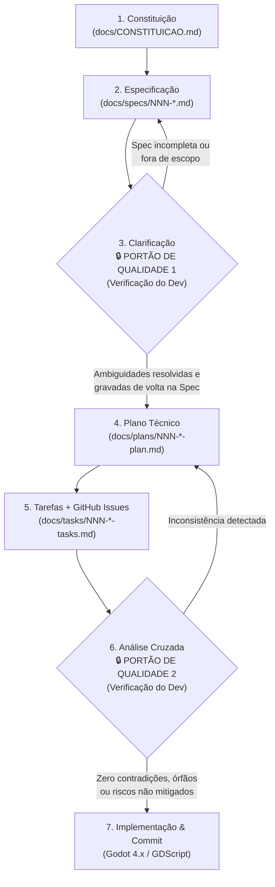

# ⚙️ Escopo e Governança do Ciclo SDD (Spec-Driven Development)

> **Projeto:** Huntress (Godot 4.x)  
> **Status:** Ativo e Obrigatório  
> **Regra de Ouro:** *Nenhum código de feature é escrito sem antes atravessar a ordem estrita do ciclo SDD e passar pela aprovação humana nos dois Portões de Qualidade.*

---

## 1. Visão Geral do Fluxo e Ordem Estrita

Todo ciclo de desenvolvimento no **Projeto Huntress** obedece invariavelmente à seguinte sequência linear:

---

## 2. Mecanismo Anti-Desvio e Retorno ao Processo (Circuit Breaker)

Seja por pressa, cansaço, preguiça do Desenvolvedor ou tendência da IA de querer pular direto para o código ("atalho agêntico"), **qualquer desvio da ordem estabelecida é bloqueado**.

### Gatilhos de Bloqueio Automático:
1. **Pulo de Etapa:** Tentar iniciar uma etapa $N$ sem que a etapa $N-1$ esteja documentada e com status `CONCLUÍDA / APROVADA`.
2. **Invasão de Escopo (Scope Creep):** Tentar projetar ou codificar algo listado na seção **Fora do Escopo (Non-Goals)** da Especificação.
3. **Código Prematuro:** Solicitar criação/edição de scripts `.gd` ou cenas `.tscn` antes da aprovação humana no **Portão de Qualidade 2 (Análise)**.
4. **Violação Constitucional:** Propor arquitetura que quebre a `docs/CONSTITUICAO.md` (ex.: scripts monolíticos, acoplamento direto sem `signals`, falta de `@export` para game feel, ausência de greyboxing).

### Protocolo de Correção:
Quando um gatilho é acionado:
1. O trabalho na ação desviada é **interrompido imediatamente**.
2. O agente aponta em qual etapa do ciclo SDD a feature se encontra atualmente.
3. O processo **retorna obrigatoriamente** para a etapa pendente até que seus critérios de saída sejam cumpridos.

---

## 3. Detalhamento das 7 Etapas do Ciclo SDD

### Etapa 1: Constituição (`docs/CONSTITUICAO.md`)
A lei máxima de engenharia e arquitetura do projeto. Toda Especificação, Plano, Tarefa e Código deve ser submisso a ela.
- **Padrão de código, arquitetura e camadas:** Filosofia de Nodes e Component Pattern (`HealthComponent`, `HitboxComponent`, `HurtboxComponent`, `InventoryComponent`), `StateMachine` isolada, comunicação desacoplada via `signals`, tipagem estática estrita em GDScript e parametrização via `@export`.
- **Política de testes e cobertura mínima:** Abordagem *Placeholder First* (Greyboxing obrigatório antes de arte final), testes automatizados de componentes e máquinas de estado, e cobertura mínima exigida por camada.
- **Requisitos de segurança e tratamento de dados:** Integridade de arquivos de Save/Load, validação de `Resources` (`.tres`) e dados do Grimório, prevenção de injeção/execução de scripts arbitrários em saves.
- **Convenções de nome, commits e estrutura de pastas:** Guia de estilo oficial da Godot 4.x, árvore de diretórios padronizada e padrão de *Conventional Commits*.

---

### Etapa 2: Especificação (`docs/specs/NNN-nome-da-feature.md`)
Define **O QUE** será construído e **POR QUE**, sob a ótica do jogador e do design do jogo, sem ainda ditar implementação de baixo nível.
- **História de Usuário / Experiência do Jogador e Fluxo Principal:** Narrativa de uso ("Como a Caçadora, quero... para que...") e passo a passo do fluxo feliz (*Happy Path*).
- **Requisitos Funcionais Numerados (`RF-001`, `RF-002`, ...):** Declarações claras, testáveis e atômicas de comportamento esperado.
- **Casos de Borda (Edge Cases) e O Que Dá Errado:** Comportamento esperado em colisões simultâneas, interrupções de estado (ex.: tomar dano durante esquiva ou leitura do Grimório), entradas inválidas ou limites de recursos.
- **Fora do Escopo (Non-Goals):** Lista explícita do que **NÃO** será feito nesta especificação. Delimitar o que fica de fora é tão importante quanto o que entra para proteger o cronograma do projeto.

---

### Etapa 3: Clarificação — 🔒 PORTÃO DE QUALIDADE 1 (Verificado pelo Desenvolvedor)
Momento de sabatina técnica e de Game Design sobre a Especificação.
- **Análise de Ambiguidade:** O agente lê a Spec minuciosamente e aponta lacunas, termos vagos (ex.: "ataque rápido", "dano alto") e casos não cobertos.
- **Perguntas Fechadas + Questionamento do "Porquê":**
  - O agente formula **perguntas fechadas** (múltipla escolha estruturada com opções de melhoria recomendadas).
  - Em cada ponto crítico, o agente **questiona o porquê** o desenvolvedor está tomando aquela decisão (validando se ela serve ao Core Loop de investigação/caça tática de *Huntress*).
- **Gravação na Spec:** As respostas e justificativas do desenvolvedor são **gravadas diretamente de volta no arquivo da Spec**, atualizando os Requisitos Funcionais (`RF-XXX`), Casos de Borda e Escopo.
- **Checklist do Portão 1 (Aprovação Pessoal do Dev):**
  - [ ] Nenhuma pergunta de clarificação permanece aberta.
  - [ ] Todas as respostas foram incorporadas ao documento da Spec.
  - [ ] Os limites de "Fora do Escopo" estão claros e blindados.
  - [ ] O Desenvolvedor deu o **"De Acordo (Portão 1 Aprovado)"** explícito.

---

### Etapa 4: Plano Técnico (`docs/plans/NNN-nome-da-feature-plan.md`)
Define **COMO** a Especificação clarificada será arquitetada na Godot 4.x.
- **Stack e Arquitetura de Nós/Cenas:** Árvore de cenas (`.tscn`), hierarquia de Nodes, componentes reutilizados ou criados e estados da `StateMachine`.
- **Modelo de Dados e Comunicação:** Definição de `Custom Resources` (`.gd` / `.tres`), estrutura de sinais (`signals`) emitidos e escutados, e variáveis `@export` de *Game Feel*.
- **Decisões Técnicas com Justificativa:** Registro das escolhas arquiteturais e seus *trade-offs* (por que usar `Area2D` vs `CharacterBody2D`, por que `Resource` vs `Dictionary`, etc.).
- **Conferência Automática contra a Constituição:** Tabela de auditoria verificando item a item se o Plano respeita 100% da `docs/CONSTITUICAO.md`.

---

### Etapa 5: Tarefas (`docs/tasks/NNN-nome-da-feature-tasks.md` + GitHub Issues)
Transforma o Plano Técnico em unidades executáveis e rastreáveis de trabalho.
- **Lista Ordenada de Tarefas (`TASK-001`, `TASK-002`, ...):** Sequência lógica de construção (ex.: Recursos de Dados $\rightarrow$ Componentes Isolados $\rightarrow$ Testes Unitários/Greybox $\rightarrow$ Integração de Cena).
- **Critério de Conclusão Claro (Definition of Done - DoD):** Como provar objetivamente que a tarefa terminou.
- **Dependências Explícitas:** Quais tarefas precisam estar prontas antes de iniciar cada item (`Bloqueada por: TASK-XXX`).
- **Vínculo de Origem:** Cada tarefa indica explicitamente quais Requisitos Funcionais (`RF-XXX`) e qual seção do Plano ela implementa.
- **Distribuição em Issues no GitHub:** As tarefas são publicadas como Issues numeradas no repositório oficial (`Varto-Kai/huntress`), permitindo rastreamento completo por commit/PR.

---

### Etapa 6: Análise — 🔒 PORTÃO DE QUALIDADE 2 (Verificado pelo Desenvolvedor)
Auditoria completa de consistência antes de escrever código.
- **Análise Cruzada (`Constituição <-> Spec <-> Plano <-> Tarefas`):**
  1. **Detecção de Contradições:** Divergências entre o que a Spec pede, o que o Plano desenha e o que a Tarefa descreve, ou violações da Constituição.
  2. **Detecção de Requisitos Órfãos:** Todo `RF-XXX` e Caso de Borda da Spec possui pelo menos uma `TASK-XXX` associada? Se não, há um requisito órfão.
  3. **Detecção de Tarefas sem Origem:** Alguma `TASK-XXX` cria código ou sistema que não veio de nenhum `RF-XXX` da Spec? Se sim, é *gold-plating* / escopo fantasma e deve ser removida ou justificada.
- **Checklist de Qualidade por Tipo de Risco:**
  - **Risco Arquitetural / Acoplamento:** Risco de dependência circular, referências hardcoded (`get_node("../../..")`) ou quebra do Component Pattern.
  - **Risco de Game Feel / Performance:** Risco de valores mágicos sem `@export`, alocações excessivas em `_physics_process`, ou física dependente de framerate.
  - **Risco de Dados / Estado:** Risco de estados inválidos na `StateMachine`, perda de pistas no Grimório ou corrupção de recursos compartilhados (`Resource` sem `duplicate()` quando necessário).
  - **Risco de Escopo / Greyboxing:** Risco de bloquear o desenvolvimento esperando arte final ou invadir itens "Fora do Escopo".
- **Checklist do Portão 2 (Aprovação Pessoal do Dev):**
  - [ ] Matriz de Rastreabilidade 100% coberta (0 órfãos, 0 tarefas sem origem, 0 contradições).
  - [ ] Riscos mapeados e mitigados nas descrições das tarefas.
  - [ ] Issues criadas/sincronizadas no GitHub.
  - [ ] O Desenvolvedor deu o **"De Acordo (Portão 2 Aprovado — Liberado para Implementação)"** explícito.

---

### Etapa 7: Implementação & Commit
Execução limpa, modular e rastreável.
- **Execução por Tarefa:** Implementação focada em uma `TASK-XXX` por vez, utilizando *Greyboxing* (caixas cinzas / formas geométricas simples) para validar a mecânica.
- **Verificação:** Execução dos testes e validação dos critérios de conclusão da tarefa.
- **Commit Padronizado & Push:** Commit seguindo a Constituição, referenciando a Issue do GitHub e mantendo o repositório remoto atualizado.
