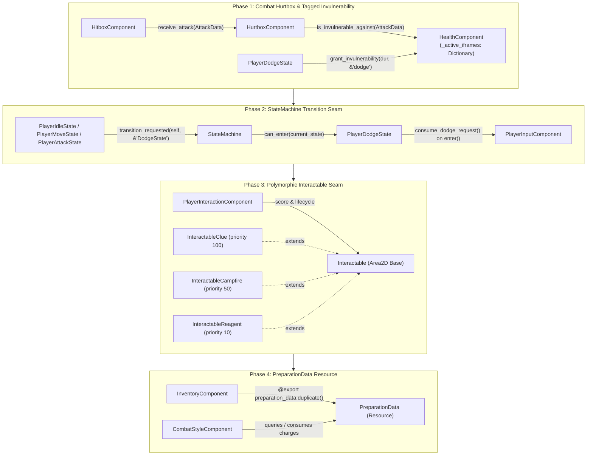

# Architectural Deepening & Seam Consolidation (Huntress Godot 4.x)

*   **Author:** Varto-Kai
*   **Status:** Draft
*   **Date:** 2026-11-20

--------------------------------------------------------------------------------

## Overview

Huntress is a 2D top-down tactical action RPG built in Godot 4.x with strict static GDScript typing. Across the first four functional specifications (`SPEC-001` player movement, `SPEC-002` combat system, `SPEC-003` investigation and grimoire, and `SPEC-004` preparation and oil crafting), the greybox vertical slice accumulated cross-component couplings and shallow forwarding wrappers.

This design defines a four-phase sequential refactoring plan that removes direct dependencies between sibling states, decouples combat hit detection from player-specific dodge states, unifies world object interactions behind a single polymorphic base class, and converts the alchemy preparation manager into a native Godot `Resource`. Completing these four stages prepares the codebase for boss lair encounters (`SPEC-005`) and village contracts (`SPEC-006`) while enforcing the modular boundaries required by Project Constitution v1.1.0.

## The Problem

Four structural bottlenecks currently increase maintenance cost and block component reuse across entities:

1.  **Player State Leakage into Combat Hurtboxes:** `HurtboxComponent` declares `@export var dodge_state: PlayerDodgeState` and calls `dodge_state.is_invulnerable()` before applying damage. Because `HurtboxComponent` is intended to be shared across the player, minor monsters, bosses, and destructible objects, referencing a player-only movement state breaks component reuse and forces non-player entities to carry unused player references.
2.  **Cross-Coupled Sibling States in the Finite State Machine:** `PlayerIdleState`, `PlayerMoveState`, and `PlayerAttackState` each hold an explicit reference to `@export var dodge_state: PlayerDodgeState` to check `dodge_state.can_dodge()` and consume input buffers. Every new state added to the player (such as parry, stun, or trap interaction) must duplicate this sibling reference and cooldown check, violating finite state machine isolation.
3.  **Procedural Branching in World Interaction:** `PlayerInteractionComponent` maintains three separate typed arrays (`_overlapping_clues`, `_overlapping_reagents`, `_overlapping_campfires`) and three focus pointers (`focused_clue`, `focused_reagent`, `focused_campfire`). Its `try_start_interaction()` method uses a fixed `if/else` chain to decide which object to trigger. Introducing new world objects (doors, chests, traps, NPCs) requires editing the player core script and adding more parallel arrays.
4.  **Shallow Pass-Through Layer in Inventory and Preparation:** `InventoryComponent` wraps a `RefCounted` instance of `PreparationManager`, manually copying `@export` variables into the manager and forwarding over a dozen methods one-to-one (`get_reagent_count`, `get_oil_charges`, `has_oil_charges`, `try_craft_recipe`). In addition, the headless CLI test runner (`tests/unit/run_tests.gd`) currently omits the two `SPEC-004` test suites (`TestPreparationManager` and `TestReagentAndCampfire`), leaving preparation and campfire regressions unverified in automated runs.

## Goals

*   **Decouple `HurtboxComponent` from `PlayerDodgeState`:** Remove all player state references from `HurtboxComponent` and centralize temporal invulnerability leases inside `HealthComponent` using string tags (`grant_invulnerability(duration, tag)`, `revoke_invulnerability(tag)`, `is_invulnerable(tag)`).
*   **Isolate Sibling States via `StateMachine` Preconditions:** Add a virtual `can_enter(from_state: State) -> bool` method to `State`, evaluate it inside `StateMachine.transition_to()`, and remove `@export var dodge_state: PlayerDodgeState` from `PlayerIdleState`, `PlayerMoveState`, and `PlayerAttackState` while preserving the 0.15s input buffer window and zero-frame dodge cancel during attack `WINDUP` and `RECOVERY` phases.
*   **Unify World Interactions Behind an `Interactable` Base Class:** Create `class_name Interactable extends Area2D` with a standardized interaction lifecycle and a composite relevance score (combining numeric priority, squared Euclidean distance, and player facing alignment), migrating `InteractableClue`, `InteractableReagent`, and `InteractableCampfire` into concrete subclasses.
*   **Convert `PreparationManager` into a `PreparationData` Resource:** Replace the `RefCounted` manager with `class_name PreparationData extends Resource`, duplicate the resource instance on component initialization (`preparation_data.duplicate()`) to prevent cross-scene state contamination, and remove one-to-one forwarding methods from `InventoryComponent`.
*   **Achieve Full Automated Test Coverage Across All Four Specs:** Register `TestPreparationManager` and `TestReagentAndCampfire` in `tests/unit/run_tests.gd` and ensure all eight unit test suites and all three greybox sandbox scenes pass without regression at the end of each phase.

## Non-Goals

*   **Gameplay Formula or Balance Changes:** Combat damage multipliers, stagger thresholds, dodge durations, oil charge capacities, and hidden prey alert penalties remain unchanged.
*   **Visual Asset Replacement:** All entities and user interfaces remain in greybox form (`ColorRect`, `Polygon2D`, `Control` containers); no pixel art sprites, shaders, or animations will be introduced.
*   **UI Layout Redesign:** Refactoring the side-by-side docking coordinate math between `GrimoireUIGreybox` and `PreparationUIGreybox` is excluded from this four-phase consolidation.
*   **New Gameplay Content:** No new monsters, clues, reagents, recipes, or boss lair rooms (`SPEC-005`) will be created during this refactoring.

## Open Questions

*   None at this stage. All architectural decisions regarding invulnerability ownership, state transition preconditions, interaction scoring, and resource conversion were resolved during the brainstorming phase.

## Critical User Journeys (CUJs)

### CUJ 1: Tactical Dodge Cancel and Tagged Invulnerability in Combat

*   **Given**: The player is in `sandbox_combat.tscn` engaging a `CombatDummy` while a `HazardPulseEmitter` fires periodic area attacks, and `PlayerAttackState` is currently executing a combo swing.
*   **When**: The player presses the dodge input during the `WINDUP` or `RECOVERY` sub-phase of an attack (or up to 0.15s before `ACTIVE` ends via the input buffer).
*   **Then**: `StateMachine.transition_to(&"DodgeState")` queries `PlayerDodgeState.can_enter(attack_state)`, confirms the phase allows cancellation, transitions to `DodgeState`, and calls `health_component.grant_invulnerability(duration, &"dodge")`. Any overlapping hazard pulse query on `HurtboxComponent` sees `health_component.is_invulnerable() == true` and ignores the hit without `HurtboxComponent` holding a reference to `PlayerDodgeState`.

### CUJ 2: Composite Focus Arbitration and Channeled Interaction Cancellation

*   **Given**: The player is in `sandbox_investigation.tscn` within interaction radius (`44.0 px`) of both an uninspected `InteractableClue` (priority `100`, hold duration `0.9s`) and an `InteractableReagent` (priority `10`, instant pickup).
*   **When**: The player faces the clue at comparable distance and holds `[E]` to inspect, then moves, dodges, or takes damage at `0.4s` elapsed time.
*   **Then**: `PlayerInteractionComponent` selects the clue via the composite relevance score, channels progress through `Interactable.update_interaction()`, and immediately calls `Interactable.cancel_interaction()` upon movement, dodge, or damage, resetting inspection progress to `0.0`.

### CUJ 3: Isolated Resource Alchemy Synthesis and Campfire Rest

*   **Given**: The player has collected reagents in the world and interacts with an `InteractableCampfire` to open the preparation workbench backed by an instance-duplicated `PreparationData` resource.
*   **When**: The player synthesizes an oil recipe (`recipe_ignis_oil.tres` or `recipe_vitriol_acid.tres`) and triggers a campfire rest.
*   **Then**: `PreparationData` atomically deducts reagents, updates oil charges, increments `region_alert_level`, and emits signals consumed by `InventoryComponent` and `PreparationUIGreybox` without mutating the shared `.tres` resource files on disk or leaking state across scene reloads.

--------------------------------------------------------------------------------

## Technical Plan (Architecture)

The refactoring executes in four dependency-ordered phases so that every intermediate commit leaves the unit test runner and all three greybox sandboxes in a working state.

### Phase 1: Combat Hurtbox Decoupling and Tagged Invulnerability (`HealthComponent`)

1.  **Tagged Invulnerability Lease Table (`src/components/health_component.gd`):**
    *   Replace the single `_invulnerability_timer: float` field with a dictionary mapping active tags to remaining durations: `var _active_iframes: Dictionary = {}` (`StringName -> float`).
    *   Add `signal invulnerability_granted(duration: float, tag: StringName)` and `signal invulnerability_expired(tag: StringName)` while keeping `signal invulnerability_changed(is_invulnerable: bool)` for existing listeners.
    *   Add public methods:
        *   `func grant_invulnerability(duration: float, tag: StringName = &"default") -> void`: If `duration <= 0.0`, returns immediately. Sets `_active_iframes[tag] = maxf(float(_active_iframes.get(tag, 0.0)), duration)` and emits `invulnerability_granted(duration, tag)` and `invulnerability_changed(true)` if transitioning from vulnerable.
        *   `func revoke_invulnerability(tag: StringName = &"") -> void`: If `tag == &""`, clears all entries in `_active_iframes`; otherwise erases `tag` and emits `invulnerability_expired(tag)`. If `_active_iframes` becomes empty, emits `invulnerability_changed(false)`.
        *   `func is_invulnerable(tag: StringName = &"") -> bool`: If `tag == &""`, returns `not _active_iframes.is_empty()`; otherwise returns `_active_iframes.has(tag)`.
        *   `func is_invulnerable_against(pierces_tags: Array[StringName]) -> bool`: Returns `true` if at least one active tag in `_active_iframes` is not present in `pierces_tags`.
    *   In `_physics_process(delta: float)`, decrement each tag's timer and erase expired tags, emitting `invulnerability_expired(tag)` and `invulnerability_changed(false)` when the last lease expires.
    *   In `apply_damage()`, trigger post-hit invulnerability via `grant_invulnerability(post_hit_invulnerability_duration, &"post_hit")`.
2.  **Attack Piercing Support (`src/data/attack_data.gd`):**
    *   Add `@export var pierces_invulnerability_tags: Array[StringName] = []` so boss attacks or environmental hazards can selectively bypass specific invulnerability tags (such as `&"dodge"`).
3.  **Dodge State Lease Integration (`src/entities/player/states/player_dodge_state.gd`):**
    *   Add `@export var health_component: HealthComponent`.
    *   On `enter()`, call `health_component.grant_invulnerability(_invulnerability_duration, &"dodge")` when `health_component != null`.
    *   On `exit()` or when `_elapsed_time >= _invulnerability_duration`, call `health_component.revoke_invulnerability(&"dodge")`.
4.  **Hurtbox Cleanup (`src/components/hurtbox_component.gd`):**
    *   Delete `@export var dodge_state: PlayerDodgeState`.
    *   `HurtboxComponent.is_invulnerable()` delegates solely to `health_component.is_invulnerable()` (and `receive_attack()` checks `health_component.is_invulnerable_against(attack_data.pierces_invulnerability_tags)`).

### Phase 2: StateMachine Transition Preconditions (`can_enter`)

1.  **State Base Contract (`src/state_machine/state.gd`):**
    *   Add virtual methods:
        *   `func can_enter(_from_state: State) -> bool: return true`
        *   `func can_cancel_into_dodge() -> bool: return true`
2.  **StateMachine Gate (`src/state_machine/state_machine.gd`):**
    *   In `transition_to(target_state_name: StringName) -> bool`, after resolving `next_state` and verifying `next_state != current_state`, evaluate `if not next_state.can_enter(current_state): return false`.
3.  **Attack Cancellation Contract (`src/entities/player/states/player_attack_state.gd`):**
    *   Override `func can_cancel_into_dodge() -> bool`: returns `current_phase == Phase.WINDUP or current_phase == Phase.RECOVERY`.
    *   Remove `@export var dodge_state: PlayerDodgeState`.
    *   When `input_component.has_buffered_dodge()` is true, emit `transition_requested.emit(self, &"DodgeState")` directly without consuming the buffer prematurely.
4.  **Dodge State Admission & Buffer Consumption (`src/entities/player/states/player_dodge_state.gd`):**
    *   Override `func can_enter(from_state: State) -> bool`:
        *   If `not can_dodge()`, returns `false`.
        *   If `from_state != null and not from_state.can_cancel_into_dodge()`, returns `false`.
        *   Returns `true`.
    *   Inside `PlayerDodgeState.enter()`, call `if input_component != null: input_component.consume_dodge_request()`.
5.  **Sibling Reference Removal (`player_idle_state.gd`, `player_move_state.gd`, `player.gd`):**
    *   Remove `@export var dodge_state: PlayerDodgeState` from `PlayerIdleState` and `PlayerMoveState`.
    *   When `input_component.has_buffered_dodge()` is true, emit `transition_requested.emit(self, &"DodgeState")`. If `PlayerDodgeState.can_enter()` returns `false` (for example, cooldown has 0.04s left), the 0.15s buffer in `PlayerInputComponent` remains unconsumed and retries on the next physics frame.

### Phase 3: Polymorphic World Interaction (`Interactable`)

1.  **Abstract Base Class (`src/entities/world/interactable.gd`):**
    *   Define `class_name Interactable extends Area2D`.
    *   Exported properties:
        *   `@export var interaction_priority: int = 0`
        *   `@export_range(0.0, 5.0, 0.05, "suffix:s") var hold_duration: float = 0.0`
    *   Virtual contract:
        *   `func can_interact(_interactor: Node2D) -> bool: return true`
        *   `func get_effective_priority() -> int: return interaction_priority`
        *   `func get_hold_duration() -> float: return maxf(0.0, hold_duration)`
        *   `func set_focused(_focused: bool) -> void`
        *   `func set_interaction_progress(_ratio: float) -> void`
        *   `func start_interaction(_interactor: Node2D) -> void`
        *   `func complete_interaction(_interactor: Node2D) -> Variant: return null`
        *   `func cancel_interaction(_interactor: Node2D) -> void`
2.  **Concrete Subclasses:**
    *   `InteractableClue` (`extends Interactable`): Default `interaction_priority = 100`. `get_effective_priority()` returns `100` when `!is_inspected` and `5` when `is_inspected` (so uninspected clues always beat inspected ones and campfires, while an inspected clue yields focus to an adjacent campfire). `get_hold_duration()` returns `inspect_duration`.
    *   `InteractableCampfire` (`extends Interactable`): Default `interaction_priority = 50`, `hold_duration = 0.0`. `complete_interaction()` calls `activate_campfire()`.
    *   `InteractableReagent` (`extends Interactable`): Default `interaction_priority = 10`, `hold_duration = 0.0`. `can_interact()` returns `not is_collected and reagent_data != null and reagent_data.is_valid()`. `complete_interaction()` calls `collect_reagent()`.
3.  **Composite Relevance Scoring in `PlayerInteractionComponent` (`src/components/player_interaction_component.gd`):**
    *   Replace `_overlapping_clues`, `_overlapping_reagents`, and `_overlapping_campfires` with a single `var _overlapping_interactables: Array[Interactable] = []` and `var focused_interactable: Interactable = null` (retaining computed getters or synchronized properties `focused_clue`, `focused_reagent`, `focused_campfire` and signals `clue_inspection_completed`, `reagent_collected_from_world`, `campfire_interacted` so existing UI and test callers continue to function without breakage).
    *   Composite Score Function `compute_interactable_score(origin: Vector2, facing: Vector2, target: Interactable) -> float`:
        *   Let $P = \text{float}(\text{target.get\_effective\_priority()})$.
        *   Let $d^2 = \text{origin.distance\_squared\_to}(\text{target.global\_position})$.
        *   Let $\text{align} = \text{facing.normalized().dot}((\text{target.global\_position} - \text{origin}).\text{normalized()})$ when $d^2 > 1.0$, else $1.0$.
        *   Let $\text{foot\_bonus} = 1200.0$ if $d^2 \le 144.0$ ($12\text{ px}$ touch zone) else $0.0$.
        *   $\text{Score} = (P \times 10.0) + \text{foot\_bonus} + (\text{align} \times 20.0) - (d^2 \times 0.05)$.
    *   Channeled progression: When `try_start_interaction()` is called on `focused_interactable`, if `get_hold_duration() <= 0.0001`, complete immediately; otherwise channel across `_physics_process(delta)` and call `cancel_active_inspection()` (resetting progress to `0.0`) if the player moves, dodges, attacks, or enters `HurtState`.

### Phase 4: PreparationData Resource & Pass-Through Elimination

1.  **Custom Resource (`src/data/preparation_data.gd` & Compatibility Alias `src/systems/preparation_manager.gd`):**
    *   Define `class_name PreparationData extends Resource` containing the reagent catalog, recipe catalog, oil charge counts, alert level scaling parameters (`@export var max_oil_charges: int = 16`, `@export var max_alert_level: int = 3`, `@export var non_weakness_penalty_per_level: float = 0.20`, `@export var stagger_scale_per_level: float = 0.15`, `@export var hazard_speedup_per_level: float = 0.12`), and serialization methods `to_dict() -> Dictionary` and `from_dict(data: Dictionary) -> void` storing primitive IDs and counts for safe JSON persistence.
    *   Emit signals directly on `PreparationData`: `reagent_count_changed(reagent_id: StringName, new_count: int)`, `oil_charges_changed(oil: CombatTypes.ElementOil, new_charges: int)`, `oil_crafted(recipe: OilRecipeData, new_charges: int)`, `crafting_failed(recipe_id: StringName, reason: String)`, `active_oil_depleted(depleted_oil: CombatTypes.ElementOil)`, and `campfire_rest_completed(new_hidden_alert_level: int)`.
    *   Keep `class_name PreparationManager extends PreparationData` as a thin subclass so existing unit tests referencing `PreparationManager.new()` continue to compile while new and updated code uses `PreparationData`.
2.  **Deepening `InventoryComponent` (`src/components/inventory_component.gd`):**
    *   Replace the duplicated `@export` parameter fields and `_sync_parameters()` boilerplate with `@export var preparation_data: PreparationData`.
    *   On `_ready()` / `ensure_default_catalog()`, duplicate the resource (`preparation_data = preparation_data.duplicate() as PreparationData` if assigned, or `PreparationData.new()`) so runtime mutations remain isolated per entity instance.
    *   Connect `preparation_data` signals to `InventoryComponent` signals and update `CombatStyleComponent` and `PreparationUIGreybox` to read state from `inventory_component.preparation_data`.
3.  **Test Runner Registration (`tests/unit/run_tests.gd`):**
    *   Register `["TestPreparationManager (SPEC-004)", TestPreparationManager.new()]` and `["TestReagentAndCampfire (SPEC-004)", TestReagentAndCampfire.new()]` in the CLI runner array.

--------------------------------------------------------------------------------

## Alternatives Considered

### Alternative A: Single Monolithic Refactoring Pass

*   **Pros**: Updates all four seams in a single commit without intermediate compatibility bridges.
*   **Cons**: Modifies movement, combat, interaction, and inventory nodes simultaneously, making it difficult to isolate the root cause if a greybox sandbox or unit test breaks.
*   **Reason for Rejection**: Rejected by author: Simultaneous changes across all core player nodes carry a high risk of untraceable regressions across physics, combat, and UI sandboxes. Phased sequential execution allows verification after each seam.

### Alternative B: Dedicated `InvulnerabilityComponent` Node

*   **Pros**: Separates invulnerability timers completely from health points and damage math.
*   **Cons**: Requires adding an extra child node and `@export` reference to every entity scene (`Player`, `CombatDummy`, future monsters, and bosses), increasing scene tree clutter for an invariant that is only ever queried when taking damage.
*   **Reason for Rejection**: Rejected by author: Centralizing tagged invulnerability leases inside `HealthComponent` avoids adding another node to every entity scene while keeping life and damage-reception rules in one place.

### Alternative C: Boolean Invulnerability Flag Controlled by `PlayerDodgeState`

*   **Pros**: Requires no timer dictionary inside `HealthComponent`; `PlayerDodgeState` simply calls `set_invulnerable(true)` on entry and `set_invulnerable(false)` on exit.
*   **Cons**: If an external event interrupts the dodge state (such as a forced state transition, knockback stun, or scene reset) and the exit cleanup path is bypassed or overlapped with post-hit invulnerability, the entity can remain permanently invulnerable or prematurely lose post-hit i-frames.
*   **Reason for Rejection**: Rejected by author: Having `HealthComponent` run its own internal countdown timer per tag (`grant_invulnerability(duration, tag)`) guarantees that invulnerability leases always expire deterministically.

### Alternative D: Passing Sibling State References Across the Finite State Machine

*   **Pros**: Avoids adding virtual precondition methods (`can_enter()`) to the base `State` class.
*   **Cons**: Forces every state that can transition into a restricted state (such as `DodgeState`) to declare an `@export` reference to that sibling state and duplicate cooldown and input-consumption logic.
*   **Reason for Rejection**: Rejected by author: Violates the isolated StateMachine rule in Project Constitution v1.1.0 and increases cognitive load whenever new states (`ParryState`, `StunState`) are introduced.

### Alternative E: Keeping `PreparationManager` as a Pure `RefCounted` Object

*   **Pros**: Lightweight memory object with zero Godot `Resource` metadata.
*   **Cons**: Cannot be inspected or assigned as a `.tres` preset in the Godot Inspector, forcing `InventoryComponent` to duplicate every configuration property as a node `@export` and maintain a shallow pass-through wrapper layer.
*   **Reason for Rejection**: Rejected by author: Converting `PreparationManager` into `PreparationData` (`extends Resource`) preserves headless unit test execution without the `SceneTree` while enabling direct Inspector configuration and eliminating redundant wrapper methods.

--------------------------------------------------------------------------------

## Non-Functional Requirements

*   **Security & Data Integrity (Constitution Section 3):**
    *   `PreparationData` catalog resources in `res://src/data/` must never be mutated in place during combat or alchemy synthesis; `InventoryComponent` must call `preparation_data.duplicate()` on initialization.
    *   Save serialization via `PreparationData.to_dict()` and `from_dict()` must use primitive dictionaries (`String`, `int`, `float`) suitable for JSON serialization in `user://saves/`, never `ResourceLoader.load()` on user-writable `.tres` files, preventing arbitrary GDScript execution from modified save files.
*   **Performance & Frame Budget:**
    *   `_overlapping_interactables` scoring in `PlayerInteractionComponent` runs only over areas overlapping the 44px radius circle (typically 0 to 4 nodes) using `distance_squared_to()` (avoiding square-root operations) and must add zero heap allocations during idle frames.
    *   Tagged invulnerability countdowns in `HealthComponent._physics_process()` iterate only over active leases (0 to 2 tags at any time).
*   **Rollout & Backward Compatibility:**
    *   Each of the four phases must preserve existing signal signatures consumed by `tests/sandboxes/sandbox_player_movement.gd`, `tests/sandboxes/sandbox_combat.gd`, and `tests/sandboxes/sandbox_investigation.gd` so that no sandbox scene breaks between phases.

--------------------------------------------------------------------------------

### Additional Resources

*   [docs/CONSTITUICAO.md](./docs/CONSTITUICAO.md) — Project Constitution v1.1.0 defining Component Pattern, StateMachine isolation, strict static typing, and resource immutability rules.
*   [docs/GDD.md](./docs/GDD.md) — Core loop and tactical hunting pillars (*CrossCode* feel + *The Witcher* preparation).
*   [concepts_brief.md](./concepts_brief.md) — Multi-lens Goldfish brainstorm brief anchoring the four architectural seams.

### Future Improvements

*   **Container-Driven UI Docking (`GrimoireUIGreybox` & `PreparationUIGreybox`):** Replace the hardcoded pixel coordinates in `GrimoireUIGreybox.set_docked_mode()` with a parent `HSplitContainer` or adaptive workbench container when expanding the UI in `SPEC-006`.
*   **Spatial Alchemy Synthesis Mini-Puzzle:** Extend `PreparationData` and `OilRecipeData` to support geometric reagent blocks (*Potion Permit* style) in post-vertical-slice iterations.

--------------------------------------------------------------------------------

## Detailed Implementation Plan

### Target Files to Create/Modify

#### 1. `src/components/health_component.gd` (Modify — Phase 1)

*   **Type / Scope**: Core Combat Component (`Node`)
*   **Proposed Changes**:
    *   **What**: Replace single-timer `_invulnerability_timer` with `_active_iframes: Dictionary` (`StringName -> float`). Add `signal invulnerability_granted(duration: float, tag: StringName)` and `signal invulnerability_expired(tag: StringName)`. Add methods `grant_invulnerability(duration: float, tag: StringName = &"default") -> void`, `revoke_invulnerability(tag: StringName = &"") -> void`, `is_invulnerable(tag: StringName = &"") -> bool`, `is_invulnerable_against(pierces_tags: Array[StringName]) -> bool`, and `get_invulnerability_remaining(tag: StringName = &"") -> float`. Route post-hit invulnerability in `apply_damage()` through `grant_invulnerability(post_hit_invulnerability_duration, &"post_hit")`.
    *   **Why**: Centralizes all temporal invulnerability leases inside `HealthComponent` so `HurtboxComponent` no longer needs a reference to `PlayerDodgeState`.

#### 2. `src/data/attack_data.gd` (Modify — Phase 1)

*   **Type / Scope**: Combat Payload Resource (`Resource`)
*   **Proposed Changes**:
    *   **What**: Add `@export var pierces_invulnerability_tags: Array[StringName] = []`.
    *   **Why**: Allows specific enemy or boss attacks to bypass selected invulnerability tags (such as `&"dodge"`) while respecting others (such as `&"parry"` or `&"post_hit"`).

#### 3. `src/components/hurtbox_component.gd` (Modify — Phase 1)

*   **Type / Scope**: Combat Hit Detection Component (`Area2D`)
*   **Proposed Changes**:
    *   **What**: Remove `@export var dodge_state: PlayerDodgeState`. Update `is_invulnerable()` to query `health_component != null and health_component.is_invulnerable()`. Update `receive_attack(attack_data: AttackData)` to check `health_component.is_invulnerable_against(attack_data.pierces_invulnerability_tags)`.
    *   **Why**: Eliminates the dependency from generic combat hurtboxes to player-specific state nodes, enabling reuse across monsters, bosses, and player entities.

#### 4. `src/entities/player/player_greybox_visual.gd` (Modify — Phase 1)

*   **Type / Scope**: Player Greybox Presentation Node (`Node2D`)
*   **Proposed Changes**:
    *   **What**: Connect to `health_component.invulnerability_granted` and `health_component.invulnerability_expired` (or inspect `health_component.is_invulnerable(&"post_hit")`) so `_is_post_hit_invulnerable` alpha blinking only triggers for the `&"post_hit"` tag and not during `&"dodge"` leases.
    *   **Why**: Prevents post-hit damage blinking from activating when `HealthComponent` grants a `&"dodge"` invulnerability lease.

#### 5. `src/state_machine/state.gd` (Modify — Phase 2)

*   **Type / Scope**: Finite State Machine Base Class (`Node`)
*   **Proposed Changes**:
    *   **What**: Add virtual precondition methods `func can_enter(_from_state: State) -> bool: return true` and `func can_cancel_into_dodge() -> bool: return true`.
    *   **Why**: Establishes a polymorphic seam for transition admission so states do not need references to sibling state nodes.

#### 6. `src/state_machine/state_machine.gd` (Modify — Phase 2)

*   **Type / Scope**: Finite State Machine Container (`Node`)
*   **Proposed Changes**:
    *   **What**: Update `transition_to(target_state_name: StringName) -> bool` to evaluate `if not next_state.can_enter(current_state): return false` before calling `current_state.exit()` and `next_state.enter()`.
    *   **Why**: Enforces target state admission preconditions centrally at the state machine seam.

#### 7. `src/entities/player/states/player_dodge_state.gd` (Modify — Phases 1 & 2)

*   **Type / Scope**: Player Movement State (`State`)
*   **Proposed Changes**:
    *   **What**: Add `@export var health_component: HealthComponent`. On `enter()`, call `input_component.consume_dodge_request()` and `health_component.grant_invulnerability(_invulnerability_duration, &"dodge")`. When i-frames end or on `exit()`, call `health_component.revoke_invulnerability(&"dodge")`. Implement `func can_enter(from_state: State) -> bool` checking `can_dodge()` and `from_state == null or from_state.can_cancel_into_dodge()`.
    *   **Why**: Moves dodge admission validation and i-frame lease registration into `PlayerDodgeState`, freeing sibling states and `HurtboxComponent` from polling dodge state internals.

#### 8. `src/entities/player/states/player_idle_state.gd` (Modify — Phase 2)

*   **Type / Scope**: Player Movement State (`State`)
*   **Proposed Changes**:
    *   **What**: Delete `@export var dodge_state: PlayerDodgeState`. In `physics_update(delta)`, when `input_component.has_buffered_dodge()` is true, emit `transition_requested.emit(self, &"DodgeState")` and check if `get_parent().current_state != self` (or whether the transition succeeded) before returning.
    *   **Why**: Removes sibling coupling between `PlayerIdleState` and `PlayerDodgeState` while preserving buffered dodge retries during the 0.15s tolerance window.

#### 9. `src/entities/player/states/player_move_state.gd` (Modify — Phase 2)

*   **Type / Scope**: Player Movement State (`State`)
*   **Proposed Changes**:
    *   **What**: Delete `@export var dodge_state: PlayerDodgeState`. In `physics_update(delta)`, when `input_component.has_buffered_dodge()` is true, emit `transition_requested.emit(self, &"DodgeState")` and continue locomotion if the transition was rejected by `can_enter()`.
    *   **Why**: Removes sibling coupling between `PlayerMoveState` and `PlayerDodgeState` without blocking movement while dodge is on cooldown.

#### 10. `src/entities/player/states/player_attack_state.gd` (Modify — Phase 2)

*   **Type / Scope**: Player Combat State (`State`)
*   **Proposed Changes**:
    *   **What**: Delete `@export var dodge_state: PlayerDodgeState`. Override `func can_cancel_into_dodge() -> bool` to return `current_phase == Phase.WINDUP or current_phase == Phase.RECOVERY`. Update `_try_dodge_cancel()` to emit `transition_requested.emit(self, &"DodgeState")` whenever `input_component.has_buffered_dodge()` is true.
    *   **Why**: Encapsulates attack phase cancellation rules behind the `State` seam and removes the direct reference to `PlayerDodgeState`.

#### 11. `src/entities/player/player.gd` (Modify — Phases 1 & 2)

*   **Type / Scope**: Player Root Entity (`CharacterBody2D`)
*   **Proposed Changes**:
    *   **What**: Remove `idle_state.dodge_state = dodge_state`, `move_state.dodge_state = dodge_state`, `attack_state.dodge_state = dodge_state`, and `hurtbox_component.dodge_state = dodge_state`. Wire `dodge_state.health_component = health_component`.
    *   **Why**: Aligns player scene composition with the decoupled hurtbox and state machine seams.

#### 12. `src/entities/player/player.tscn` (Modify — Phases 1 & 2)

*   **Type / Scope**: Player PackedScene (`PackedScene`)
*   **Proposed Changes**:
    *   **What**: Remove serialized `dodge_state` `NodePath` assignments from `HurtboxComponent`, `IdleState`, `MoveState`, and `AttackState`. Add `health_component = NodePath("../../HealthComponent")` to `DodgeState`.
    *   **Why**: Prevents Godot scene loader warnings for deleted `@export var dodge_state` properties.

#### 13. `src/entities/world/interactable.gd` (Create — Phase 3)

*   **Type / Scope**: Polymorphic World Interaction Base Class (`Area2D`)
*   **Proposed Changes**:
    *   **What**: Create `class_name Interactable extends Area2D` with `@export var interaction_priority: int = 0`, `@export var hold_duration: float = 0.0`, collision layer 8 / mask 0 defaults, and virtual methods `can_interact(interactor: Node2D) -> bool`, `get_effective_priority() -> int`, `get_hold_duration() -> float`, `set_focused(focused: bool) -> void`, `set_interaction_progress(ratio: float) -> void`, `start_interaction(interactor: Node2D) -> void`, `complete_interaction(interactor: Node2D) -> Variant`, and `cancel_interaction(interactor: Node2D) -> void`.
    *   **Why**: Defines the single polymorphic seam for all interactive objects in the game world.

#### 14. `src/entities/world/interactable_clue.gd` (Modify — Phase 3)

*   **Type / Scope**: World Investigation Entity (`Interactable`)
*   **Proposed Changes**:
    *   **What**: Change base class from `Area2D` to `Interactable`. Set default `interaction_priority = 100`. Override `get_effective_priority() -> int` (returns `interaction_priority` when `!is_inspected`, `5` when `is_inspected`), `get_hold_duration() -> float` (returns `inspect_duration`), `set_interaction_progress(ratio: float) -> void` (delegates to `set_inspection_progress(ratio)`), `complete_interaction(_interactor: Node2D) -> Variant` (calls `complete_inspection()`), and `cancel_interaction(_interactor: Node2D) -> void` (resets progress to `0.0`).
    *   **Why**: Adapts physical clues to the `Interactable` contract while preserving reread capability at lower priority than campfires.

#### 15. `src/entities/world/interactable_reagent.gd` (Modify — Phase 3)

*   **Type / Scope**: World Collectible Reagent Entity (`Interactable`)
*   **Proposed Changes**:
    *   **What**: Change base class from `Area2D` to `Interactable`. Set default `interaction_priority = 10` and `hold_duration = 0.0`. Override `can_interact(_interactor: Node2D) -> bool` (returns `not is_collected and reagent_data != null and reagent_data.is_valid()`) and `complete_interaction(_interactor: Node2D) -> Variant` (returns `collect_reagent()`).
    *   **Why**: Adapts alchemy reagent nodes to the `Interactable` contract.

#### 16. `src/entities/world/interactable_campfire.gd` (Modify — Phase 3)

*   **Type / Scope**: World Campfire & Workbench Entity (`Interactable`)
*   **Proposed Changes**:
    *   **What**: Change base class from `Area2D` to `Interactable`. Set default `interaction_priority = 50` and `hold_duration = 0.0`. Override `complete_interaction(_interactor: Node2D) -> Variant` (calls `activate_campfire()` and returns `self`).
    *   **Why**: Adapts campfire stations to the `Interactable` contract.

#### 17. `src/components/player_interaction_component.gd` (Modify — Phase 3)

*   **Type / Scope**: Player Interaction Detector & Channeler (`Area2D`)
*   **Proposed Changes**:
    *   **What**: Replace parallel arrays with `_overlapping_interactables: Array[Interactable] = []` and `focused_interactable: Interactable = null`. Implement `static func compute_interactable_score(origin: Vector2, facing: Vector2, target: Interactable) -> float` and `static func select_best_interactable(origin: Vector2, facing: Vector2, candidates: Array[Interactable]) -> Interactable` (retaining `select_best_clue` as a compatibility wrapper). Unify `try_start_interaction()`, `_physics_process(delta)`, and `cancel_active_inspection()` against `Interactable` virtual methods while emitting existing domain signals (`clue_inspection_completed`, `reagent_collected_from_world`, `campfire_interacted`) for backward compatibility with `Player` and sandboxes.
    *   **Why**: Deepens `PlayerInteractionComponent` so new world interactables require zero changes to the player interaction script.

#### 18. `src/data/preparation_data.gd` (Create — Phase 4)

*   **Type / Scope**: Alchemy & Loadout State Resource (`Resource`)
*   **Proposed Changes**:
    *   **What**: Create `class_name PreparationData extends Resource` containing the `@export` parameters (`max_oil_charges`, `max_alert_level`, `non_weakness_penalty_per_level`, `stagger_scale_per_level`, `hazard_speedup_per_level`, `known_reagents`, `known_recipes`), reagent and oil charge dictionaries, crafting and silent prey adaptation methods, domain signals (`reagent_count_changed`, `oil_charges_changed`, `oil_crafted`, `crafting_failed`, `active_oil_depleted`, `campfire_rest_completed`), and safe JSON serialization methods `to_dict() -> Dictionary` and `from_dict(data: Dictionary) -> void`.
    *   **Why**: Consolidates preparation logic and Inspector configuration into a single serializable and headlessly testable `Resource`.

#### 19. `src/systems/preparation_manager.gd` (Modify — Phase 4)

*   **Type / Scope**: Backward-Compatible Alias Class (`PreparationData`)
*   **Proposed Changes**:
    *   **What**: Change `class_name PreparationManager` to `extends PreparationData` so any direct callers or unit tests instantiating `PreparationManager.new()` operate on the unified `PreparationData` resource implementation.
    *   **Why**: Eliminates duplicated logic between `PreparationManager` and `PreparationData` while maintaining 100% compatibility with existing tests.

#### 20. `src/components/inventory_component.gd` (Modify — Phase 4)

*   **Type / Scope**: Player Inventory Scene Connector (`Node`)
*   **Proposed Changes**:
    *   **What**: Add `@export var preparation_data: PreparationData` (aliased to `var manager: PreparationData` getter for compatibility), instantiate or call `preparation_data = preparation_data.duplicate() as PreparationData` on `_ready()` / `ensure_default_catalog()`, and bridge `preparation_data` signals directly.
    *   **Why**: Ensures runtime resource isolation across scenes and removes manual parameter-copying boilerplate.

#### 21. `tests/unit/test_combat_components_and_states.gd` (Modify — Phases 1 & 2)

*   **Type / Scope**: Automated Component Test Suite (`RefCounted`)
*   **Proposed Changes**:
    *   **What**: Update `_build_combat_rig()` to remove deleted `dodge_state` assignments on `idle_state`, `move_state`, `attack_state`, and `hurtbox`, and wire `dodge_state.health_component = health`. Add assertion verifying tagged invulnerability (`&"dodge"` vs `&"post_hit"`) and `pierces_invulnerability_tags` on `HealthComponent`.
    *   **Why**: Aligns the combat test harness with the Phase 1 and Phase 2 seams and tests tagged i-frame piercing.

#### 22. `tests/unit/test_player_state_machine.gd` (Modify — Phase 2)

*   **Type / Scope**: Automated StateMachine Test Suite (`RefCounted`)
*   **Proposed Changes**:
    *   **What**: Update `_build_test_rig()` to remove `idle_state.dodge_state = dodge_state` and `move_state.dodge_state = dodge_state`. Add assertion verifying `StateMachine.transition_to(&"DodgeState")` consults `PlayerDodgeState.can_enter()`.
    *   **Why**: Verifies that sibling states transition and buffer dodges solely through the `StateMachine.can_enter()` seam.

#### 23. `tests/unit/test_interaction_and_clues.gd` (Modify — Phase 3)

*   **Type / Scope**: Automated Interaction Test Suite (`RefCounted`)
*   **Proposed Changes**:
    *   **What**: Add test case verifying composite relevance scoring (`PlayerInteractionComponent.select_best_interactable`) when an `InteractableReagent` is within the 12px foot zone versus an `InteractableClue` at 36px, and when an inspected clue yields focus to an adjacent `InteractableCampfire`.
    *   **Why**: Verifies the polymorphic `Interactable` seam and composite relevance arbitration.

#### 24. `tests/unit/test_preparation_manager.gd` (Modify — Phase 4)

*   **Type / Scope**: Automated Preparation & Resource Test Suite (`RefCounted`)
*   **Proposed Changes**:
    *   **What**: Add test case verifying `PreparationData.duplicate()` isolation in `InventoryComponent` and round-trip serialization via `to_dict()` / `from_dict()`.
    *   **Why**: Verifies Constitution Section 3 data immutability and safe JSON save serialization.

#### 25. `tests/unit/run_tests.gd` (Modify — Phase 4)

*   **Type / Scope**: CLI Headless Test Runner (`SceneTree`)
*   **Proposed Changes**:
    *   **What**: Append `["TestPreparationManager (SPEC-004)", TestPreparationManager.new()]` and `["TestReagentAndCampfire (SPEC-004)", TestReagentAndCampfire.new()]` to the `suites` array and update banner text to `SPEC-001 a SPEC-004`.
    *   **Why**: Ensures all eight unit test suites execute in automated CLI runs.

### Verification Plan

*   **Compilation & Static Typing Check**: Run Godot 4.x in headless mode (`godot --headless --path . --quit`) to verify zero GDScript parse errors, zero `untyped_declaration` warnings, and zero broken `NodePath` warnings in `player.tscn` and sandbox scenes.
*   **Automated Unit & Component Tests**: Execute `godot --headless --path . -s res://tests/unit/run_tests.gd` and require `0 FAIL` across all 8 suites (`TestMovementMath`, `TestPlayerStateMachine`, `TestCombatDamageResolver`, `TestCombatComponentsAndStates`, `TestGrimoireTracker`, `TestInteractionAndClues`, `TestPreparationManager`, `TestReagentAndCampfire`).
*   **Greybox Sandbox Verification**: Load and verify `res://tests/sandboxes/sandbox_player_movement.tscn`, `res://tests/sandboxes/sandbox_combat.tscn`, and `res://tests/sandboxes/sandbox_investigation.tscn` to confirm zero regressions in movement feel, dodge cancel timing, clue channeling, reagent collection, and campfire workbench synthesis.

--------------------------------------------------------------------------------

<!-- Provenance: Indicates initial structural drafting via EGM. -->

*Drafted with EGM*
