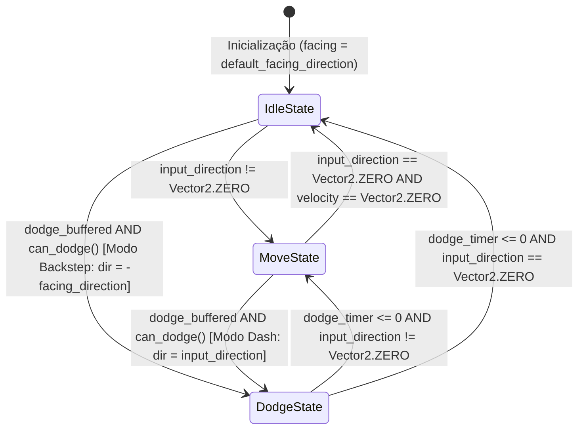

# 📊 Modelo de Dados, Estados e Contratos de Sinais: `001-player-movement`

**Feature**: `specs/001-player-movement`  
**Data**: 2026-10-20

---

## 1. Entidades e Recursos (`Custom Resources`)

### 1.1. `PlayerMovementConfig` (`Resource`)
- **Caminho**: `res://src/data/player_movement_config.gd`
- **Recurso Padrão**: `res://src/data/default_player_movement.tres`
- **Campos e Regras de Validação**:
  - `max_speed: float = 200.0` (`> 0.0`)
  - `y_axis_speed_ratio: float = 1.0` (`0.5` a `1.5`)
  - `acceleration: float = 1800.0` (`> 0.0`)
  - `friction: float = 1600.0` (`> 0.0`)
  - `default_facing_direction: Vector2 = Vector2.DOWN` (normalizado; fallback para `Vector2.DOWN` se `Vector2.ZERO`)
  - `dodge_speed: float = 460.0` (`> 0.0`)
  - `backstep_speed_multiplier: float = 0.75` (`0.25` a `1.5`)
  - `dodge_end_speed_factor: float = 0.35` (`0.0` a `1.0`)
  - `dodge_duration: float = 0.24` (`>= 0.05`)
  - `invulnerability_duration: float = 0.16` (sanitizado via `clampf(invulnerability_duration, 0.0, dodge_duration)`)
  - `dodge_cooldown: float = 0.35` (`>= 0.0`)
  - `dodge_input_buffer_time: float = 0.12` (`>= 0.0`)

---

## 2. Diagrama de Transição de Estados (`StateMachine`)

### Invariantes de Estado:
1. **`facing_direction` Nunca é Zero**: `MovementComponent` inicializa `facing_direction` com `config.default_facing_direction.normalized()`. Em `MoveState`, só atualiza `facing_direction` quando `input_direction.length_squared() > 0.0001`. Em `DodgeState`, se for *Backstep*, `facing_direction` permanece inalterada; se for *Dash* direcional, `facing_direction` alinha-se à direção travada do *Dash*.
2. **Direção da Esquiva é Imutável Durante `DodgeState`**: O vetor `_locked_dodge_direction` é capturado em `enter()` e mantido até `exit()`, ignorando alterações no direcional até o término de `dodge_duration`.
3. **Recarga (*Cooldown*) Pós-Esquiva**: O temporizador `_cooldown_timer` inicia ao sair de `DodgeState` (`exit()`) e decresce a cada frame. Uma nova transição para `DodgeState` só é permitida quando `_cooldown_timer <= 0.0`.

---

## 3. Cores Semânticas do Greybox (`PlayerGreyboxVisual`)

| Estado / Condição | Cor Semântica (Hex) | Significado Visual no Teste |
| :--- | :--- | :--- |
| `IdleState` | `#2ECC71` (Verde Esmeralda) | Caçadora em repouso, pronta para agir. |
| `MoveState` | `#58D68D` (Verde Claro Vibrante) | Caçadora em locomoção ativa. |
| `DodgeState` (*i-frames* ativos) | `#00D2FF` (Azul Ciano Brilhante) | Esquiva ativa com invulnerabilidade ligada (`RF-006`). |
| `DodgeState` (*Recovery* sem *i-frames*) | `#F39C12` (Laranja / Âmbar) | Terço final de desaceleração da esquiva (vulnerável). |
| Indicador `FacingIndicator` | `#FFFFFF` (Branco Puro) | Seta frontal indicando a direção exata de `facing_direction` (`RF-009`). |
