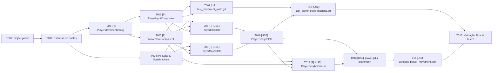

# ✅ Tarefas & Análise Cruzada: Movimentação Base, Esquiva e StateMachine da Caçadora

**Diretório da Feature**: `specs/001-player-movement`  
**Pré-requisitos**: `spec.md` (🔒 Portão 1 Aprovado) e `plan.md` (Constitution Check Aprovado)  
**Status no Ciclo SDD**: `[x] 5. Tarefas Definidas` | `[x] 6. Análise Cruzada (🔒 Portão 2 Aprovado)` | `[x] 7. Implementado`

---

## Formato das Tarefas: `[ID] [P?] [Story] Descrição com caminho exato + Critério de Conclusão`

- **`[P]`**: Pode ser executada em paralelo (arquivos distintos, sem dependência pendente).
- **`[US#]`**: História de usuário (`[US1]`, `[US2]`, `[US3]`) + Requisitos Funcionais e Casos de Borda de origem (`RF-XXX`, `EC-XXX`).
- **Critério de Conclusão (DoD)** e **Dependências** explícitos em cada tarefa.
- **Distribuição em Issues**: Pronta para sincronização com o GitHub (`Varto-Kai/huntress`) via `/speckit-github-taskstoissues`.

---

## Fase 1: Setup & Infraestrutura Base

- [x] T001 Inicializar `project.godot` na raiz do repositório com configuração Godot 4.x, tipagem estática estrita (`untyped_declaration` e `inferred_declaration` como erro), resolução base 2D Pixel Art e `InputMap` (`move_up`, `move_down`, `move_left`, `move_right`, `dodge`)
  - **Origem**: `RF-001`, `RF-005`, `plan.md` (Seção 2 e 6) | **Depende de**: Nenhuma | **Issue**: `#TBD`
  - **Critério de Conclusão (DoD)**: `project.godot` carrega sem erros na Godot 4.x, ações de input mapeadas para Teclado (`WASD`/Setas + `Espaço`/`Shift`) e avisos de tipagem estática ativados.
- [x] T002 Criar a árvore de diretórios oficial em `src/components/`, `src/data/`, `src/state_machine/`, `src/entities/player/states/`, `tests/unit/` e `tests/sandboxes/`
  - **Origem**: `plan.md` (Seção 6), Constituição (Seção 4.2) | **Depende de**: `T001` | **Issue**: `#TBD`
  - **Critério de Conclusão (DoD)**: Estrutura de diretórios criada exatamente conforme a Seção 4.2 da Constituição.

---

## Fase 2: Fundacional (Componentes, Recursos e StateMachine Bloqueantes)

**⚠️ CRÍTICO**: Deve estar concluída antes da integração nas histórias de usuário.

- [x] T003 [P] Implementar o Custom Resource `PlayerMovementConfig` em `src/data/player_movement_config.gd` e criar instância padrão em `src/data/default_player_movement.tres`
  - **Origem**: `RF-008`, `EC-003`, `EC-006`, `DT-02` | **Depende de**: `T002` | **Issue**: `#TBD`
  - **Critério de Conclusão (DoD)**: Contém todos os 12 parâmetros `@export` (`max_speed = 200.0`, `y_axis_speed_ratio = 1.0`, `acceleration = 1800.0`, `friction = 1600.0`, `default_facing_direction = Vector2.DOWN`, `dodge_speed = 460.0`, `backstep_speed_multiplier = 0.75`, `dodge_end_speed_factor = 0.35`, `dodge_duration = 0.24`, `invulnerability_duration = 0.16`, `dodge_cooldown = 0.35`, `dodge_input_buffer_time = 0.12`) com `@export_range` e método de sanitização (`clampf(invulnerability_duration, 0.0, dodge_duration)` e fallback de `default_facing_direction` para `Vector2.DOWN` se `Vector2.ZERO`).
- [x] T004 [P] Implementar a classe base `State` em `src/state_machine/state.gd` e o orquestrador `StateMachine` em `src/state_machine/state_machine.gd`
  - **Origem**: `RF-003`, `SC-002`, `DT-01` | **Depende de**: `T002` | **Issue**: `#TBD`
  - **Critério de Conclusão (DoD)**: `State` define `enter()`, `exit()`, `update(delta: float)`, `physics_update(delta: float)` e `signal transition_requested(from_state: State, to_state_name: StringName)`. `StateMachine` gerencia estado inicial via `@export var initial_state: State`, valida transições, emite `signal state_changed(previous_state_name: StringName, new_state_name: StringName)` e implementa `_get_configuration_warnings()`.
- [x] T005 [P] Implementar o componente de física `MovementComponent` em `src/components/movement_component.gd`
  - **Origem**: `RF-001`, `RF-002`, `RF-004`, `EC-004`, `EC-006` | **Depende de**: `T003` | **Issue**: `#TBD`
  - **Critério de Conclusão (DoD)**: Calcula aceleração e desaceleração via `Vector2.move_toward()`, aplica `y_axis_speed_ratio`, preserva `facing_direction` normalizada (nunca `Vector2.ZERO`), emite `facing_direction_changed` e `velocity_updated`, e executa `move_and_slide()` no `CharacterBody2D` configurado com `MOTION_MODE_FLOATING`.
- [x] T006 [P] Implementar o componente de entrada `PlayerInputComponent` em `src/entities/player/player_input_component.gd`
  - **Origem**: `RF-001`, `EC-001`, `EC-003`, `EC-005`, `DT-04` | **Depende de**: `T003` | **Issue**: `#TBD`
  - **Critério de Conclusão (DoD)**: Captura vetor normalizado (`length <= 1.0`), anula inputs opostos simultâneos no mesmo eixo (`EC-001` resultando em `0.0` sem jitter), zera entradas ao receber `NOTIFICATION_APPLICATION_FOCUS_OUT` (`EC-005`) e mantém temporizador de *Input Buffer* (`dodge_input_buffer_time`) consumível via `consume_dodge_request() -> bool`.

---

## Fase 3: User Story 1 - Locomoção Direcional Responsiva (*CrossCode Feel*) (Prioridade: P1) 🎯 MVP

**Objetivo**: Entregar movimentação em 8 direções / 360° normalizada, com aceleração rápida, parada por atrito e transição limpa entre `Idle` e `Move`.  
**Teste Independente**: Executar testes unitários de matemática de movimento e mover a Caçadora entre `Idle` e `Move` sem ganho indevido de velocidade diagonal.

- [x] T007 [P] [US1] Implementar o estado `PlayerIdleState` em `src/entities/player/states/player_idle_state.gd`
  - **Origem**: `RF-002`, `RF-003`, `EC-001` | **Depende de**: `T004`, `T005`, `T006` | **Issue**: `#TBD`
  - **Critério de Conclusão (DoD)**: Aplica desaceleração por atrito (`friction`) até `Vector2.ZERO` no `MovementComponent` e solicita transição para `MoveState` quando `input_direction != Vector2.ZERO` (ou para `DodgeState` quando esquiva solicitada e fora de cooldown).
- [x] T008 [P] [US1] Implementar o estado `PlayerMoveState` em `src/entities/player/states/player_move_state.gd`
  - **Origem**: `RF-001`, `RF-002`, `RF-003`, `RF-004` | **Depende de**: `T004`, `T005`, `T006` | **Issue**: `#TBD`
  - **Critério de Conclusão (DoD)**: Aplica aceleração (`acceleration`) até `max_speed` na direção normalizada, atualiza `facing_direction`, e solicita transição para `IdleState` quando `input_direction == Vector2.ZERO` e a velocidade atinge `Vector2.ZERO`.
- [x] T009 [US1] Criar testes unitários de matemática de locomoção, normalização diagonal e eixos opostos em `tests/unit/test_movement_math.gd`
  - **Origem**: `RF-001`, `RF-002`, `EC-001`, `EC-005`, `EC-006`, `SC-001` | **Depende de**: `T005`, `T006` | **Issue**: `#TBD`
  - **Critério de Conclusão (DoD)**: Valida automaticamente que a velocidade diagonal tem variação `<= 0.01%` em relação à cardinal (`SC-001`), que eixos opostos resultam em `0.0` (`EC-001`), que a perda de foco limpa o vetor (`EC-005`) e que `y_axis_speed_ratio` escala corretamente o eixo Y (`EC-006`).

---

## Fase 4: User Story 2 - Esquiva Tática (*Dash / Dodge / Backstep*) (Prioridade: P2)

**Objetivo**: Implementar o estado `Dodge` com direção travada, suporte a *Backstep* em `Idle`, janela de *i-frames* desde o frame 1, desaceleração no terço final (*recovery*), *cooldown* e *Input Buffer*.  
**Teste Independente**: Acionar esquiva em movimento (*Dash*) e parada (*Backstep*), verificando *i-frames*, desaceleração final, *cooldown* e disparo imediato via *Input Buffer*.

- [x] T010 [US2] Implementar o estado `PlayerDodgeState` em `src/entities/player/states/player_dodge_state.gd`
  - **Origem**: `RF-005`, `RF-006`, `RF-007`, `EC-002`, `EC-003`, `EC-004`, `DT-05` | **Depende de**: `T007`, `T008` | **Issue**: `#TBD`
  - **Critério de Conclusão (DoD)**: Trava a direção no `enter()` (usando `input_direction` em movimento ou `-facing_direction` com `backstep_speed_multiplier` quando em `Idle`, sem inverter `facing_direction`), ativa `_is_invulnerable = true` no frame 1 até `invulnerability_duration`, desacelera até `dodge_end_speed_factor` no terço final (`recovery`), inicia `dodge_cooldown` no `exit()`, emite os sinais `dodge_started`, `dodge_ended`, `invulnerability_started`, `invulnerability_ended` e `dodge_cooldown_updated`, e transita ao fim para `MoveState` ou `IdleState`.
- [x] T011 [US2] Criar testes automatizados de componente para a `StateMachine` e `PlayerDodgeState` em `tests/unit/test_player_state_machine.gd` (e runner `tests/unit/run_tests.gd`)
  - **Origem**: `RF-003`, `RF-005`, `RF-006`, `RF-007`, `EC-002`, `EC-003`, `SC-002` | **Depende de**: `T009`, `T010` | **Issue**: `#TBD`
  - **Critério de Conclusão (DoD)**: Testa transições no frame seguinte (`SC-002`), travamento de direção durante `Dodge`, *Backstep* mantendo `facing_direction` (`EC-002`), encerramento dos *i-frames* antes do fim de `dodge_duration` (`RF-006`), bloqueio durante *cooldown* (`RF-007`) e consumo do *Input Buffer* nos últimos `0.12s` (`EC-003`).

---

## Fase 5: User Story 3 - Leitura Visual em Greybox, Entidade `Player` e Cena Sandbox (Prioridade: P3)

**Objetivo**: Construir a representação visual geométrica (`PlayerGreyboxVisual`), montar a cena completa `player.tscn` e criar a arena `sandbox_player_movement.tscn` para validação interativa em menos de 30 segundos.  
**Teste Independente**: Abrir `res://tests/sandboxes/sandbox_player_movement.tscn` e validar visualmente cores de estado, *i-frames*, seta de `facing_direction` e colisão em paredes/quinas.

- [x] T012 [P] [US3] Implementar o componente visual `PlayerGreyboxVisual` em `src/entities/player/player_greybox_visual.gd`
  - **Origem**: `RF-004`, `RF-009`, `SC-004` | **Depende de**: `T004`, `T005`, `T010` | **Issue**: `#TBD`
  - **Critério de Conclusão (DoD)**: Desenha/atualiza `Polygon2D` do corpo com cores semânticas configuráveis via `@export` (`#2ECC71` em `Idle`, `#58D68D` em `Move`, `#00D2FF` em `Dodge` com *i-frames* ativos, `#F39C12` em `Dodge` *recovery* sem *i-frames*) e rotaciona a seta `FacingIndicator` (`#FFFFFF`) conforme o sinal `facing_direction_changed`.
- [x] T013 [US3] Implementar o script container `Player` em `src/entities/player/player.gd` e montar a cena `src/entities/player/player.tscn`
  - **Origem**: `RF-003`, `RF-004`, `RF-008`, `RF-009`, `EC-004`, `DT-03` | **Depende de**: `T010`, `T012` | **Issue**: `#TBD`
  - **Critério de Conclusão (DoD)**: Cena `CharacterBody2D` montada com `CollisionShape2D` (`CircleShape2D` para *wall sliding* suave), `PlayerGreyboxVisual`, `PlayerInputComponent`, `MovementComponent` e `StateMachine` (`IdleState`, `MoveState`, `DodgeState`), expondo `@export var movement_config: PlayerMovementConfig` no nó raiz `Player` para edição ao vivo no Inspector (`SC-003`).
- [x] T014 [US3] Criar a cena `tests/sandboxes/sandbox_player_movement.tscn` e script de telemetria `tests/sandboxes/sandbox_player_movement.gd`
  - **Origem**: `RF-010`, `EC-004`, `SC-003`, `SC-004` | **Depende de**: `T013` | **Issue**: `#TBD`
  - **Critério de Conclusão (DoD)**: Arena Greybox contendo piso contrastante, paredes retas, quinas de 45° e 90°, pilares circulares/quadrados e um painel HUD de depuração mostrando estado atual, velocidade instantânea (`px/s`), `facing_direction`, status de *i-frames*, *cooldown* e *input buffer*.

---

## Fase 6: Polimento, Parametrização e Validação Final

- [x] T015 Executar a suíte completa de testes (`tests/unit/run_tests.gd`) e validar todos os critérios `SC-001` a `SC-004` na cena Sandbox
  - **Origem**: `SC-001`, `SC-002`, `SC-003`, `SC-004` | **Depende de**: `T011`, `T014` | **Issue**: `#TBD`
  - **Critério de Conclusão (DoD)**: 100% dos testes unitários/componentes passando em modo headless, zero avisos/erros de tipagem estática na Godot 4.x, zero números mágicos fora de `@export`.

---

## Dependências & Execução Paralela

- **Oportunidades de Paralelismo (`[P]`)**:
  - **Fase 2**: `T003` (`PlayerMovementConfig`) e `T004` (`StateMachine`) podem ser desenvolvidas em paralelo; em seguida, `T005` (`MovementComponent`) e `T006` (`PlayerInputComponent`) rodam em paralelo.
  - **Fase 3 (`US1`)**: `T007` (`PlayerIdleState`), `T008` (`PlayerMoveState`) e `T009` (`test_movement_math.gd`) atuam em arquivos independentes.
  - **Fase 5 (`US3`)**: `T012` (`PlayerGreyboxVisual`) pode ser construído em paralelo com os testes `T011`.

---

## 🔒 PORTÃO DE QUALIDADE 2: Análise Cruzada (`/speckit-analyze`)

> *Preenchido na Etapa 6 antes de qualquer execução do `/speckit-implement`. O Desenvolvedor verifica pessoalmente este relatório.*

### 1. Matriz de Rastreabilidade (`Constituição <-> Spec <-> Plano <-> Tarefas`)

| Requisito / Caso de Borda (`spec.md`) | Seção do Plano (`plan.md`) | Tarefa(s) (`tasks.md`) | Regra Constitucional | Status |
| :--- | :--- | :--- | :--- | :---: |
| `RF-001` (Input 4 eixos normalizado $\le 1.0$) | Seção 2.2, `research.md` §1 | `T001`, `T005`, `T006`, `T008`, `T009` | Seção 1.2.1 (Component Pattern) | ✅ Coberto |
| `RF-002` (Aceleração e Atrito progressivos) | Seção 2.2, `research.md` §2 | `T005`, `T007`, `T008`, `T009` | Seção 1.2.1 (`MovementComponent`) | ✅ Coberto |
| `RF-003` (`StateMachine`: `Idle`, `Move`, `Dodge`) | Seção 2.2, `DT-01` | `T004`, `T007`, `T008`, `T010`, `T011`, `T013` | Seção 1.2.2 (`StateMachine` Isolada) | ✅ Coberto |
| `RF-004` (Registro de `facing_direction` + padrão) | Seção 2.2, Seção 3.3 | `T003`, `T005`, `T008`, `T012`, `T013` | Seção 1.2.3 (Signals First) | ✅ Coberto |
| `RF-005` (`Dodge` trava direção + *Backstep* em `Idle`) | Seção 2.2, `DT-05`, `research.md` §3 | `T001`, `T007`, `T008`, `T010`, `T011` | Seção 1.2.2 (Estados Isolados) | ✅ Coberto |
| `RF-006` (*i-frames* frame 1 + *recovery* vulnerável + sinais) | Seção 3.2, `DT-05`, `research.md` §3 | `T010`, `T011`, `T012` | Seção 1.2.3 (*Call Down, Signal Up*) | ✅ Coberto |
| `RF-007` (Temporizador de *cooldown* pós-esquiva) | Seção 2.2, Seção 3.3 | `T003`, `T010`, `T011` | Seção 1.2.4 (Parametrização) | ✅ Coberto |
| `RF-008` (12 parâmetros de *Game Feel* via `@export`) | Seção 3.3, `DT-02` | `T003`, `T013`, `T015` | Seção 1.2.4 (Zero Números Mágicos) | ✅ Coberto |
| `RF-009` (Visual Greybox por estado/i-frames + seta frontal) | Seção 2.2, `data-model.md` §3 | `T012`, `T013`, `T014` | Seção 2.1 (*Placeholder First*) | ✅ Coberto |
| `RF-010` (Cena *Sandbox Greybox* com obstáculos) | Seção 2.2, `quickstart.md` | `T014`, `T015` | Seção 2.2 (Cobertura de Gameplay) | ✅ Coberto |
| `EC-001` (Inputs opostos simultâneos se anulam sem jitter) | Seção 2.2, `research.md` §1 | `T006`, `T007`, `T009` | Seção 2.2 (Testes de Borda) | ✅ Coberto |
| `EC-002` (Esquiva em `Idle` executa *Backstep* mantendo olhar) | Seção 2.2, `research.md` §3 | `T007`, `T010`, `T011` | Seção 2.2 (Testes de Componente) | ✅ Coberto |
| `EC-003` (*Input Buffer* de esquiva ~`0.12s` durante dodge/cooldown) | Seção 3.3, `DT-04` | `T003`, `T006`, `T010`, `T011` | Seção 1.2.4 (`@export`) | ✅ Coberto |
| `EC-004` (*Wall sliding* suave em paredes/quinas sem travar) | Seção 2.2, `DT-03`, `research.md` §2 | `T005`, `T010`, `T013`, `T014` | Seção 2.2 (Validação Sandbox) | ✅ Coberto |
| `EC-005` (Perda de foco da janela zera input e vai para `Idle`) | Seção 2.2, `research.md` §1 | `T006`, `T009` | Seção 3.3 (Fail-Safe) | ✅ Coberto |
| `EC-006` (Física Top-Down 1:1 com `@export y_axis_speed_ratio`) | Seção 3.3, `research.md` §2 | `T003`, `T005`, `T009` | Seção 1.2.4 (`@export`) | ✅ Coberto |

### 2. Auditoria de Consistência e Anomalias
- **Contradições entre `Constituição <-> Spec <-> Plano <-> Tarefas`**: `Nenhuma detectada.`
- **Requisitos Órfãos (Requisito na Spec sem Tarefa correspondente)**: `Nenhum detectado (10/10 RF e 6/6 EC possuem tarefas e testes dedicados).`
- **Tarefas sem Origem (Tarefa que não deriva de nenhum Requisito da Spec)**: `Nenhuma detectada (T001 a T015 possuem rastreabilidade direta).`

### 3. Checklist de Qualidade por Tipo de Risco

| Categoria de Risco | Verificação Realizada | Mitigação nas Tarefas | Status |
| :--- | :--- | :--- | :---: |
| **1. Risco Arquitetural / Acoplamento** | Há scripts monolíticos ou chamadas `get_parent()` frágeis? | Decomposição em 10 scripts pequenos (`T003` a `T014`), injeção via `@export` no `Player` (`T013`) e comunicação ascendente exclusiva por `signal` (`T004`, `T005`, `T010`). | ✅ |
| **2. Risco de Game Feel / Performance** | Há números mágicos na física ou falta de `@export`? | Todos os 12 parâmetros estão em `PlayerMovementConfig` (`T003`) e zero alocações ocorrem em `_physics_process`. | ✅ |
| **3. Risco de Dados / Estado** | Há risco de mutação de `Resource` compartilhado ou estado inválido na `StateMachine`? | Sanitização `clampf` de `invulnerability_duration <= dodge_duration` (`T003`), validação `_get_configuration_warnings()` (`T004`) e testes de transição (`T011`). | ✅ |
| **4. Risco de Escopo / Greyboxing** | Alguma tarefa invade o "Fora do Escopo" ou exige arte final antes do Greybox? | Zero referência a ataque, vida, pistas ou sprites Pixel Art; validação 100% em `Polygon2D` semântico (`T012`, `T014`). | ✅ |

### 4. Assinatura Pessoal do Desenvolvedor (Portão 2)
- [x] Matriz de Rastreabilidade sem contradições, sem requisitos órfãos e sem tarefas sem origem.
- [x] Checklist de Qualidade por Tipo de Risco 100% validado.
- [ ] Tarefas prontas/distribuídas em Issues no GitHub (`Varto-Kai/huntress`) — *Script `/speckit-github-taskstoissues` pronto aguardando `GH_TOKEN`/autenticação GitHub CLI*.
- [x] **Verificado e aprovado pessoalmente pelo Desenvolvedor para Implementação em:** `2026-10-20`
