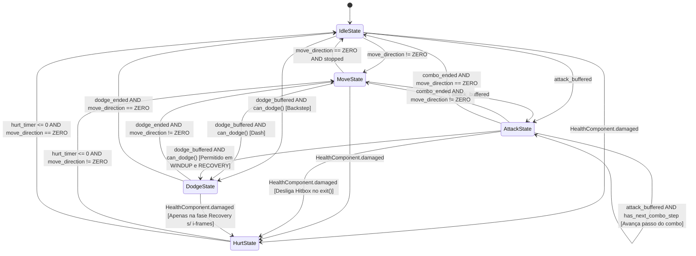

# 📊 Modelo de Dados, Estados e Contratos de Sinais: `002-combat-system`

**Feature**: `specs/002-combat-system`  
**Data**: 2026-10-20

---

## 1. Enums e Tipos de Domínio (`CombatTypes`)

- **`CombatTypes.Team`**:
  - `PLAYER = 0`
  - `ENEMY = 1`
  - `NEUTRAL = 2`
- **`CombatTypes.StyleType`**:
  - `FAST_STEEL = 0` (*Postura Rápida / Corte — Combo de 3 golpes ágeis*)
  - `HEAVY_IMPACT = 1` (*Postura Pesada / Quebra-Guarda — Combo de 2 impactos pesados*)
- **`CombatTypes.ElementOil`**:
  - `NONE = 0` (*Lâmina Limpa*)
  - `IGNIS_OIL = 1` (*Óleo Ígneo — Eficaz contra Feras Ágeis / Orgânicos*)
  - `VITRIOL_ACID = 2` (*Óleo de Vitríolo Ácido — Corrói Couraças Pesadas*)
- **`CombatTypes.MatchupResult`**:
  - `RESISTED = 0` (Multiplicador combinado `< 0.95`)
  - `NEUTRAL = 1` (Multiplicador combinado entre `0.95` e `1.15`)
  - `WEAKNESS = 2` (Multiplicador combinado `> 1.15`)

---

## 2. Diagrama de Estados Expandido da Caçadora (`StateMachine`)

---

## 3. Cores Semânticas do Greybox de Combate

| Entidade / Estado | Cor Semântica (Hex) | Significado Visual no Teste |
| :--- | :--- | :--- |
| `Player` em `AttackState` (`WINDUP`) | `#F1C40F` (Amarelo Ouro) | Preparando golpe (janela aberta para *Dodge Cancel*). |
| `Player` em `AttackState` (`ACTIVE`) | `#E74C3C` (Vermelho Carmesim) | Golpe cortando ativamente (comprometido com o impacto). |
| `Player` em `AttackState` (`RECOVERY`) | `#E67E22` (Laranja Escuro) | Recuperação pós-golpe (janela aberta para *Dodge Cancel* ou próximo hit do combo). |
| `Player` em `HurtState` | `#FF0055` (Magenta / Vermelho Choque) | Sofrendo recuo (*knockback*) de dano recebido. |
| `Player` com *i-frames* pós-dano | Alternância de opacidade (`0.45` $\leftrightarrow$ `1.0`) | Piscar visual indicando invulnerabilidade pós-dano ativa. |
| `HitboxComponent` (`SlashVisual`) | `#FF3B30` (Corte Rápido) / `#FF9500` (Impacto Pesado) | Polígono da lâmina/impacto projetado à frente da `facing_direction`. |
| `CombatDummy` Normal vs. *Staggered* | `#8E44AD` (Roxo) $\rightarrow$ `#00FFFF` (Ciano Piscante em *Break*) | Indica visualmente quando a postura do monstro foi quebrada. |
