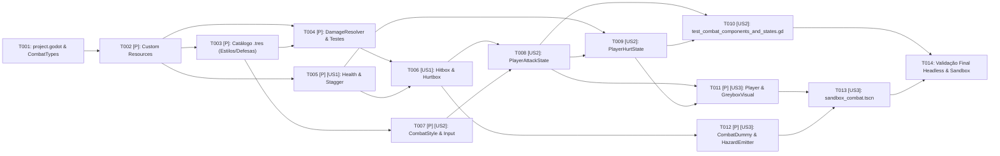

# ✅ Tarefas & Análise Cruzada: Sistema de Combate Base, Hitbox/Hurtbox e Estilos/Fraquezas (Greybox)

**Diretório da Feature**: `specs/002-combat-system`  
**Pré-requisitos**: `spec.md` (🔒 Portão 1 Aprovado) e `plan.md` (Constitution Check Aprovado)  
**Status no Ciclo SDD**: `[x] 5. Tarefas Definidas` | `[x] 6. Análise Cruzada (🔒 Portão 2 Aprovado)` | `[x] 7. Implementado`

---

## Formato das Tarefas: `[ID] [P?] [Story] Descrição com caminho exato + Critério de Conclusão`

- **`[P]`**: Pode ser executada em paralelo (arquivos distintos, sem dependência pendente).
- **`[US#]`**: História de usuário (`[US1]`, `[US2]`, `[US3]`) + Requisitos Funcionais e Casos de Borda de origem (`RF-XXX`, `EC-XXX`).
- **Critério de Conclusão (DoD)** e **Dependências** explícitos em cada tarefa.
- **Distribuição em Issues**: Pronta para sincronização com o GitHub (`Varto-Kai/huntress`) via `/speckit-github-taskstoissues`.

---

## Fase 1: Setup & Tipos Fundamentais de Combate

- [x] T001 Atualizar `project.godot` com as ações de entrada `attack` (`J`, `Enter`, Botão Esquerdo do Mouse), `switch_style` (`Q`, `Tab`) e `switch_oil` (`E`), e criar `CombatTypes` em `src/core/combat_types.gd`
  - **Origem**: `RF-002`, `RF-004`, `RF-006`, `plan.md` (Seção 2.2) | **Depende de**: Nenhuma | **Issue**: `#TBD`
  - **Critério de Conclusão (DoD)**: `CombatTypes` declara os enums `Team` (`PLAYER`, `ENEMY`, `NEUTRAL`), `StyleType` (`FAST_STEEL`, `HEAVY_IMPACT`), `ElementOil` (`NONE`, `IGNIS_OIL`, `VITRIOL_ACID`) e `MatchupResult` (`RESISTED`, `NEUTRAL`, `WEAKNESS`), e `project.godot` mapeia as 3 ações de combate sem erros.

---

## Fase 2: Fundacional (Custom Resources, Cálculo de Fraquezas e Componentes Base)

**⚠️ CRÍTICO**: Deve estar concluída antes da integração nos estados da Caçadora e alvos de combate.

- [x] T002 [P] Implementar os Custom Resources `AttackData` (`src/data/attack_data.gd`), `AttackStepData` (`src/data/attack_step_data.gd`), `CombatStyleData` (`src/data/combat_style_data.gd`) e `DefenseProfileData` (`src/data/defense_profile_data.gd`), além de expandir `PlayerMovementConfig` (`src/data/player_movement_config.gd` e `default_player_movement.tres`) com `combo_input_buffer_time = 0.18` e `hurt_duration = 0.22`
  - **Origem**: `RF-002`, `RF-004`, `RF-006`, `RF-008`, `RF-009`, `EC-005` | **Depende de**: `T001` | **Issue**: `#TBD`
  - **Critério de Conclusão (DoD)**: Todos os `Resources` possuem tipagem estática 100%, variáveis `@export` com `@export_range` e métodos `sanitize()` que previnem valores nulos ou divisões por zero (`EC-005`).
- [x] T003 [P] Criar os recursos de catálogo `.tres` para os 2 Estilos de Luta (`src/data/style_fast_steel.tres` com combo de 3 cortes ágeis e `src/data/style_heavy_impact.tres` com combo de 2 impactos pesados) e para os 2 Perfis de Defesa (`src/data/defense_armored_carapace.tres` e `src/data/defense_agile_beast.tres`)
  - **Origem**: `RF-004`, `RF-006`, `RF-009` | **Depende de**: `T002` | **Issue**: `#TBD`
  - **Critério de Conclusão (DoD)**: Recursos `.tres` carregam sem erros na Godot 4.7.2 e refletem os multiplicadores de Resistência (`0.5x`/`0.25x`), Neutro (`1.0x`) e Fraqueza (`1.5x`/`2.0x`).
- [x] T004 [P] Implementar o resolvedor matemático puro `DamageResolver` em `src/systems/damage_resolver.gd` e seus testes unitários em `tests/unit/test_combat_damage_resolver.gd`
  - **Origem**: `RF-004`, `EC-005`, `SC-002`, `DT-02` | **Depende de**: `T002`, `T003` | **Issue**: `#TBD`
  - **Critério de Conclusão (DoD)**: Calcula dano final, dano de postura (*stagger*), vetor de *knockback* e classificação `MatchupResult` considerando Estilo, Óleo, estado *Staggered* (`staggered_damage_multiplier`) e fallbacks para argumentos nulos (`EC-005`), com $\ge 90\%$ de cobertura nos testes unitários.

---

## Fase 3: User Story 1 - Componentes Modulares de Vida, Postura, Hitbox e Hurtbox (Prioridade: P1) 🎯 MVP

**Objetivo**: Entregar os componentes independentes `HealthComponent`, `StaggerComponent`, `HitboxComponent` e `HurtboxComponent` respeitando *i-frames* e garantindo 1 acerto único por golpe por alvo.  
**Teste Independente**: Executar testes automatizados de colisão `Hitbox <-> Hurtbox`, verificando prevenção de *multi-hit* (`SC-001`), bloqueio por *i-frames* (`SC-003`) e quebra de postura (*Stagger*).

- [x] T005 [P] [US1] Implementar `HealthComponent` em `src/components/health_component.gd` e `StaggerComponent` em `src/components/stagger_component.gd`
  - **Origem**: `RF-001`, `RF-004`, `RF-008`, `RF-009` | **Depende de**: `T002` | **Issue**: `#TBD`
  - **Critério de Conclusão (DoD)**: `HealthComponent` gerencia HP, ativa janela de *i-frames* pós-dano (`post_hit_invulnerability_duration`) e emite `damaged`, `healed`, `health_changed`, `invulnerability_changed` e `health_depleted` (uma única vez ao zerar). `StaggerComponent` acumula *stagger*, decai fora de combate e gerencia a janela de *Break* (`stagger_started`, `stagger_ended`, `stagger_changed`).
- [x] T006 [US1] Implementar `HitboxComponent` em `src/components/hitbox_component.gd` e `HurtboxComponent` em `src/components/hurtbox_component.gd`
  - **Origem**: `RF-002`, `RF-003`, `RF-004`, `EC-001`, `EC-002`, `SC-001`, `SC-003`, `DT-01` | **Depende de**: `T004`, `T005` | **Issue**: `#TBD`
  - **Critério de Conclusão (DoD)**: `HitboxComponent` rastreia `_hit_hurtboxes` por ativação para garantir exatamente 1 hit por alvo por golpe (`EC-001`, `SC-001`), suporta múltiplos alvos simultâneos (`EC-002`) e redimensiona seu shape/polígono Greybox conforme `AttackStepData`. `HurtboxComponent` checa equipe (`team`), consulta *i-frames* do `PlayerDodgeState` e do `HealthComponent` (`RF-003`, `SC-003`), resolve o impacto via `DamageResolver` e aplica ao `HealthComponent` e `StaggerComponent`.

---

## Fase 4: User Story 2 - Ataque Direcional, Combos por Estilo, *Dodge Cancel* e `PlayerHurtState` (Prioridade: P2)

**Objetivo**: Expandir a Caçadora com `CombatStyleComponent`, `PlayerAttackState` (combos de 3 cortes / 2 impactos e *Dodge Cancel*) e `PlayerHurtState` (recuo físico com cancelamento seguro de hitbox).  
**Teste Independente**: Executar testes de estado validando combos, *Dodge Cancel* no *windup* e *recovery* (bloqueado no *active* com buffer) e interrupção segura por `PlayerHurtState`.

- [x] T007 [P] [US2] Implementar `CombatStyleComponent` em `src/components/combat_style_component.gd` e expandir `PlayerInputComponent` (`src/entities/player/player_input_component.gd`) com buffer de ataque e comandos de troca de Estilo/Óleo
  - **Origem**: `RF-004`, `RF-006`, `RF-009` | **Depende de**: `T003` | **Issue**: `#TBD`
  - **Critério de Conclusão (DoD)**: `CombatStyleComponent` alterna entre `style_fast_steel.tres` e `style_heavy_impact.tres` e entre os 3 estados de `ElementOil`, gerando o `AttackData` de cada passo do combo. `PlayerInputComponent` gerencia `_attack_buffer_timer` (`combo_input_buffer_time`), `consume_attack_request()` e sinais/flags de troca de Estilo e Óleo.
- [x] T008 [US2] Implementar `PlayerAttackState` em `src/entities/player/states/player_attack_state.gd` e atualizar `PlayerIdleState` / `PlayerMoveState` para transitar para `AttackState`
  - **Origem**: `RF-005`, `RF-006`, `RF-007`, `EC-003`, `EC-004`, `DT-03`, `DT-04` | **Depende de**: `T006`, `T007` | **Issue**: `#TBD`
  - **Critério de Conclusão (DoD)**: Executa as sub-fases `WINDUP` $\rightarrow$ `ACTIVE` $\rightarrow$ `RECOVERY` orientadas por `facing_direction`, aplica avanço frontal (`attack_step_speed`), encadeia golpes do combo via buffer (`3 cortes` em `FAST_STEEL`, `2 impactos` em `HEAVY_IMPACT`), permite *Dodge Cancel* em `WINDUP` e `RECOVERY` (bloqueando em `ACTIVE` mas retendo no buffer para disparar no 1º frame de `RECOVERY`), e desativa incondicionalmente a `HitboxComponent` no `exit()`.
- [x] T009 [US2] Implementar `PlayerHurtState` em `src/entities/player/states/player_hurt_state.gd`
  - **Origem**: `RF-005`, `RF-008`, `EC-003` | **Depende de**: `T005`, `T008` | **Issue**: `#TBD`
  - **Critério de Conclusão (DoD)**: Ao receber o sinal `damaged` do `HealthComponent` da Caçadora, força transição imediata para `HurtState` (desligando qualquer hitbox ativa via `AttackState.exit()`), aplica impulso de *knockback* desacelerado por atrito durante `hurt_duration` e retorna para `MoveState` ou `IdleState`.
- [x] T010 [US2] Criar testes automatizados de componentes de combate e estados (`AttackState`, `HurtState`, *Dodge Cancel*, *i-frames*, *multi-hit*) em `tests/unit/test_combat_components_and_states.gd` e registrar no `tests/unit/run_tests.gd`
  - **Origem**: `RF-001` a `RF-008`, `EC-001` a `EC-004`, `SC-001`, `SC-003` | **Depende de**: `T008`, `T009` | **Issue**: `#TBD`
  - **Critério de Conclusão (DoD)**: Valida em modo headless: 1 hit único por golpe por alvo (`SC-001`), imunidade total durante *i-frames* do `Dodge` e pós-dano (`SC-003`), combo de 3 hits vs 2 hits, *Dodge Cancel* bloqueado em `ACTIVE` e disparado em `RECOVERY`, e cancelamento de hitbox ao entrar em `HurtState` (`EC-003`).

---

## Fase 5: User Story 3 - Leitura Visual Greybox de Combate, `CombatDummy` e Arena Sandbox (Prioridade: P3)

**Objetivo**: Atualizar `PlayerGreyboxVisual` e `player.tscn` com os nós de combate, construir a entidade `CombatDummy` (`combat_dummy.tscn`) e o emissor de perigo `HazardPulseEmitter`, e montar a cena `sandbox_combat.tscn`.  
**Teste Independente**: Abrir `res://tests/sandboxes/sandbox_combat.tscn` e validar visualmente combos, troca de Estilo/Óleo, multiplicadores de Fraqueza/Resistência, quebra de postura (*Stagger*), *Dodge Cancel* e `PlayerHurtState` em menos de 30 segundos.

- [x] T011 [P] [US3] Atualizar `PlayerGreyboxVisual` (`src/entities/player/player_greybox_visual.gd`), `Player` (`src/entities/player/player.gd`) e `src/entities/player/player.tscn` com `WeaponPivot/HitboxComponent`, `HurtboxComponent`, `HealthComponent`, `CombatStyleComponent`, `AttackState` e `HurtState`
  - **Origem**: `RF-005`, `RF-008`, `RF-010` | **Depende de**: `T008`, `T009` | **Issue**: `#TBD`
  - **Critério de Conclusão (DoD)**: `PlayerGreyboxVisual` exibe cores distintas para `WINDUP` (`#F1C40F`), `ACTIVE` (`#E74C3C`), `RECOVERY` (`#E67E22`) e `HurtState` (`#FF0055`), pisca a opacidade durante os *i-frames* pós-dano e desenha o polígono de corte na `HitboxComponent` durante a fase `ACTIVE`.
- [x] T012 [P] [US3] Implementar o alvo tático `CombatDummy` (`src/entities/monsters/combat_dummy.gd` e `src/entities/monsters/combat_dummy.tscn`) e o emissor de ataque inimigo `HazardPulseEmitter` (`src/entities/monsters/hazard_pulse_emitter.gd`)
  - **Origem**: `RF-004`, `RF-010`, `SC-002`, `SC-003`, `SC-004` | **Depende de**: `T006` | **Issue**: `#TBD`
  - **Critério de Conclusão (DoD)**: `CombatDummy` integra `HealthComponent`, `StaggerComponent`, `HurtboxComponent` e `MovementComponent`, desenha barras geométricas de HP e Postura acima da cabeça, muda de cor em *Break / Staggered* (`#00FFFF`), exibe o último resultado de acerto (`RESISTIDO`, `NEUTRO`, `FRAQUEZA!`) e restaura o HP automaticamente após 1.5s quando derrotado para treino contínuo. `HazardPulseEmitter` emite pulsos periódicos telegrafados para testar *i-frames* da esquiva e `PlayerHurtState`.
- [x] T013 [US3] Criar a cena `tests/sandboxes/sandbox_combat.tscn` e script de telemetria `tests/sandboxes/sandbox_combat.gd` (definindo-a como cena principal de validação rápida ou mantendo atalho direto)
  - **Origem**: `RF-010`, `SC-004` | **Depende de**: `T011`, `T012` | **Issue**: `#TBD`
  - **Critério de Conclusão (DoD)**: Arena Greybox contendo a Caçadora, 1 *Dummy Couraçado* (`defense_armored_carapace.tres`), 1 *Dummy Fera Ágil* (`defense_agile_beast.tres`), 1 *Totem Emissor de Perigo* (`HazardPulseEmitter`) e painel HUD completo mostrando Estilo ativo, Passo do Combo, Fase do Golpe, Óleo equipado, HP/i-frames da Caçadora e log do último impacto causado/recebido.

---

## Fase 6: Polimento, Parametrização e Validação Final

- [x] T014 Executar a suíte completa de testes (`tests/unit/run_tests.gd` cobrindo `SPEC-001` + `SPEC-002`) no Godot 4.7.2 e validar a cena `sandbox_combat.tscn`
  - **Origem**: `SC-001`, `SC-002`, `SC-003`, `SC-004` | **Depende de**: `T010`, `T013` | **Issue**: `#TBD`
  - **Critério de Conclusão (DoD)**: 100% dos testes unitários e de componente (`SPEC-001` + `SPEC-002`) passando em modo headless no Godot 4.7.2, zero erros/avisos de tipagem estática e todos os scripts dentro do limite constitucional de linhas.

---

## Dependências & Execução Paralela

---

## 🔒 PORTÃO DE QUALIDADE 2: Análise Cruzada (`/speckit-analyze`)

> *Preenchido na Etapa 6 antes de qualquer execução do `/speckit-implement`. O Desenvolvedor verifica pessoalmente este relatório.*

### 1. Matriz de Rastreabilidade (`Constituição <-> Spec <-> Plano <-> Tarefas`)

| Requisito / Caso de Borda (`spec.md`) | Seção do Plano (`plan.md`) | Tarefa(s) (`tasks.md`) | Regra Constitucional | Status |
| :--- | :--- | :--- | :--- | :---: |
| `RF-001` (`HealthComponent` + *i-frames* pós-dano + sinais) | Seção 2.2, Seção 3.2 | `T005`, `T010`, `T011` | Seção 1.2.1 (Component Pattern) | ✅ Coberto |
| `RF-002` (`HitboxComponent` / `HurtboxComponent` + `AttackData`) | Seção 2.2, `DT-01` | `T001`, `T002`, `T006`, `T010` | Seção 1.2.1 (Component Pattern) | ✅ Coberto |
| `RF-003` (Respeito aos *i-frames* do `Dodge` e pós-dano) | Seção 2.2, `research.md` §1 | `T006`, `T010`, `T012` | Seção 1.2.3 (Signals First) | ✅ Coberto |
| `RF-004` (Estilos, Óleos, Fraquezas/Resistências e *Stagger*) | Seção 2.2, Seção 3.1, `DT-02` | `T002`, `T003`, `T004`, `T005`, `T007`, `T012` | Seção 2.2 ($\ge 90\%$ Cobertura Cálculo) | ✅ Coberto |
| `RF-005` (`PlayerAttackState` e `PlayerHurtState` + `facing_direction`) | Seção 2.1, Seção 2.2 | `T008`, `T009`, `T010`, `T011` | Seção 1.2.2 (`StateMachine` Isolada) | ✅ Coberto |
| `RF-006` (Combo de 3 cortes em `FAST_STEEL` e 2 impactos em `HEAVY_IMPACT`) | Seção 3.1, `DT-03`, `research.md` §2 | `T003`, `T007`, `T008`, `T010` | Seção 1.2.4 (Parametrização `@export`) | ✅ Coberto |
| `RF-007` (*Dodge Cancel* permitido em `WINDUP` e `RECOVERY`, retido em `ACTIVE`) | Seção 2.2, `DT-03`, `research.md` §2 | `T008`, `T010` | Seção 1.2.2 (Transições Seguras) | ✅ Coberto |
| `RF-008` (`PlayerHurtState` com *knockback*, cancelamento de ataque e *i-frames*) | Seção 2.2, `DT-04` | `T002`, `T005`, `T009`, `T010`, `T011` | Seção 1.2.2 (`StateMachine` Isolada) | ✅ Coberto |
| `RF-009` (Parâmetros de *Game Feel* de combate via `@export`) | Seção 3.3 | `T002`, `T003`, `T014` | Seção 1.2.4 (Zero Números Mágicos) | ✅ Coberto |
| `RF-010` (Visual Greybox de combate + `sandbox_combat.tscn`) | Seção 2.1, `data-model.md` §3 | `T011`, `T012`, `T013`, `T014` | Seção 2.1 (*Placeholder First*) | ✅ Coberto |
| `EC-001` (Exatamente 1 hit por alvo por golpe ativo) | `DT-01`, `research.md` §1 | `T006`, `T010` | Seção 2.2 (Cobertura de Componente) | ✅ Coberto |
| `EC-002` (Acerto simultâneo em 2 alvos no mesmo frame) | `DT-01` | `T006`, `T010` | Seção 2.2 (Testes de Borda) | ✅ Coberto |
| `EC-003` (Dano recebido durante `AttackState` desliga hitbox no `exit()`) | `DT-04` | `T008`, `T009`, `T010` | Seção 3.3 (Fail-Safe) | ✅ Coberto |
| `EC-004` (*Dodge Cancel* desliga hitbox imediatamente no `exit()`) | `DT-04`, `research.md` §2 | `T008`, `T010` | Seção 3.3 (Fail-Safe) | ✅ Coberto |
| `EC-005` (`AttackData` ou `DefenseProfileData` nulo usa fallback seguro) | Seção 2.2, `DT-02` | `T002`, `T004` | Seção 3.3 (Validação Defensiva) | ✅ Coberto |

### 2. Auditoria de Consistência e Anomalias
- **Contradições entre `Constituição <-> Spec <-> Plano <-> Tarefas`**: `Nenhuma detectada.`
- **Requisitos Órfãos (Requisito na Spec sem Tarefa correspondente)**: `Nenhum detectado (10/10 RF e 5/5 EC possuem tarefas e testes dedicados).`
- **Tarefas sem Origem (Tarefa que não deriva de nenhum Requisito da Spec)**: `Nenhuma detectada (T001 a T014 possuem rastreabilidade direta).`

### 3. Checklist de Qualidade por Tipo de Risco

| Categoria de Risco | Verificação Realizada | Mitigação nas Tarefas | Status |
| :--- | :--- | :--- | :---: |
| **1. Risco Arquitetural / Acoplamento** | Há scripts monolíticos ou acoplamento direto entre `Player` e `CombatDummy`? | Interação 100% mediada por `HitboxComponent` $\rightarrow$ `HurtboxComponent` carregando `AttackData` (`T006`). Zero referência cruzada entre entidades. | ✅ |
| **2. Risco de Game Feel / Performance** | Há números mágicos nos tempos de ataque/stagger ou risco de travamento por *hitstop*? | Todos os tempos e multiplicadores residem em `CombatStyleData` e `DefenseProfileData` (`T002`, `T003`). | ✅ |
| **3. Risco de Dados / Estado** | Há risco de "hitbox fantasma" continuar ativa após sofrer dano ou esquivar? | `PlayerAttackState.exit()` invoca incondicionalmente `hitbox_component.deactivate()` (`T008`, `T010`). | ✅ |
| **4. Risco de Escopo / Greyboxing** | Alguma tarefa invade a `SPEC-003` (Pistas/Grimório) ou exige arte Pixel Art? | Escopo estritamente contido no combate e multiplicadores em Greybox (`Polygon2D` e barras geométricas). | ✅ |

### 4. Assinatura Pessoal do Desenvolvedor (Portão 2)
- [x] Matriz de Rastreabilidade sem contradições, sem requisitos órfãos e sem tarefas sem origem.
- [x] Checklist de Qualidade por Tipo de Risco 100% validado.
- [ ] Tarefas prontas/distribuídas em Issues no GitHub (`Varto-Kai/huntress`) — *Script `/speckit-github-taskstoissues` pronto*.
- [x] **Verificado e aprovado pessoalmente pelo Desenvolvedor para Implementação em:** `2026-10-20`
