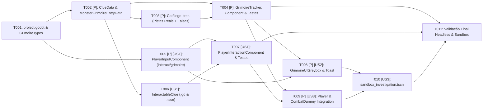

# ✅ Tarefas & Análise Cruzada: Sistema de Investigação (Coleta de Pistas) e Grimório Dinâmico (Greybox)

**Diretório da Feature**: `specs/003-investigation-grimoire`  
**Pré-requisitos**: `spec.md` (🔒 Portão 1 Aprovado) e `plan.md` (Constitution Check Aprovado)  
**Status no Ciclo SDD**: `[x] 5. Tarefas Definidas` | `[x] 6. Análise Cruzada (🔒 Portão 2 Aprovado)` | `[x] 7. Implementado`

---

## Formato das Tarefas: `[ID] [P?] [Story] Descrição com caminho exato + Critério de Conclusão`

- **`[P]`**: Pode ser executada em paralelo (arquivos distintos, sem dependência pendente).
- **`[US#]`**: História de usuário / Requisito Funcional de origem (`RF-XXX`, `EC-XXX`).
- **Critério de Conclusão (DoD)** e **Dependências** explícitos em cada tarefa.
- **Distribuição em Issues**: Sincronizado com o GitHub (`Varto-Kai/huntress`) via `/speckit-github-taskstoissues`.

---

## Fase 1: Setup & Infraestrutura de Inputs e Tipos

- [x] T001 Configurar ações `interact` (`E`) e `toggle_grimoire` (`Tab` / `G`) em `project.godot` e criar `GrimoireTypes` em `src/core/grimoire_types.gd`
  - **Origem**: `RF-001`, `RF-004`, `RF-006`, `plan.md` (§2.2) | **Depende de**: Nenhuma | **Issue**: `#1`
  - **Critério de Conclusão (DoD)**: `InputMap` com ações `interact` e `toggle_grimoire` registradas; `GrimoireTypes` declarando enums estritos (`SectionType`, `ClueVisualShape`) sem erros no Godot 4.7.2.

---

## Fase 2: Fundacional (Custom Resources, Catálogo `.tres` de Pistas Autênticas/Falsas e `GrimoireTracker`)

**⚠️ CRÍTICO**: Deve estar concluída antes da integração nos componentes de interação e na interface do Grimório.

- [x] T002 [P] Implementar os `Custom Resources` `ClueData` (`src/data/clue_data.gd`) e `MonsterGrimoireEntryData` (`src/data/monster_grimoire_entry_data.gd`)
  - **Origem**: `RF-004`, `RF-008`, `EC-005` | **Depende de**: `T001` | **Issue**: `#2`
  - **Critério de Conclusão (DoD)**: Classes `Resource` 100% tipadas com `@export` para vínculo 1:1 de seção (`section_type`), flag de pista falsa (`is_false_lead`), Estilo/Óleo apontados, fórmula de materiais do Óleo fabricável (`concluded_oil_recipe`) e validação defensiva `sanitize()`.
- [x] T003 [P] Criar catálogo `.tres` de investigação em `src/data/` (6 pistas autênticas, 2 pistas falsas *Red Herrings* e 2 fichas `MonsterGrimoireEntryData`: `entry_armored_carapace.tres` e `entry_agile_beast.tres`)
  - **Origem**: `RF-004`, `RF-009`, `data-model.md` (§3) | **Depende de**: `T002` | **Issue**: `#3`
  - **Critério de Conclusão (DoD)**: Recursos `.tres` criados e vinculados aos perfis `defense_armored_carapace.tres` e `defense_agile_beast.tres`, incluindo receitas de materiais dos Óleos (`VITRIOL_ACID` e `IGNIS_OIL`) e descrições dedutivas para julgamento manual das pistas falsas.
- [x] T004 [P] Implementar o motor dedutivo puro `GrimoireTracker` (`src/systems/grimoire_tracker.gd`), o componente `GrimoireComponent` (`src/components/grimoire_component.gd`) e a suíte unitária `tests/unit/test_grimoire_tracker.gd`
  - **Origem**: `RF-003`, `RF-004`, `RF-005`, `EC-002`, `EC-005`, `EC-006`, `SC-001` | **Depende de**: `T002`, `T003` | **Issue**: `#4`
  - **Critério de Conclusão (DoD)**: Registro idempotente por `clue_id`, suporte a `toggle_clue_discarded(clue_id)`, contaminação de seção quando pista falsa (`is_false_lead = true`) está ativa, resolução precisa quando pista falsa é descartada, e cobertura $\ge 90\%$ em `test_grimoire_tracker.gd`.

---

## Fase 3: User Story 1 - Detecção e Inspeção de Pistas Físicas no Mapa (Prioridade: P1) 🎯 MVP

**Objetivo**: Permitir que a Caçadora detecte pistas no chão, priorize a não inspecionada mais próxima e execute a canalização curta cancelável (`0.5s`).  
**Teste Independente**: Aproximar-se de pistas sobrepostas, inspecionar com barra de progresso e testar cancelamento por esquiva/movimento/dano.

- [x] T005 [P] [US1] Expandir `PlayerInputComponent` (`src/entities/player/player_input_component.gd`) com sinais `interact_pressed`, `grimoire_toggle_requested`, flag `is_interact_held` e trava `gameplay_inputs_blocked`
  - **Origem**: `RF-001`, `RF-006`, `EC-003` | **Depende de**: `T001` | **Issue**: `#5`
  - **Critério de Conclusão (DoD)**: Inputs de interação e abertura do Grimório funcionando; quando `gameplay_inputs_blocked == true`, movimentos e ataques da Caçadora são zerados/ignorados com segurança.
- [x] T006 [US1] Implementar a entidade de mundo `InteractableClue` (`src/entities/world/interactable_clue.gd` e `src/entities/world/interactable_clue.tscn`)
  - **Origem**: `RF-002`, `RF-008` | **Depende de**: `T002` | **Issue**: `#6`
  - **Critério de Conclusão (DoD)**: `Area2D` na camada de interativos com visual *Greybox* configurável via `@export` (formas distintas por `ClueVisualShape`, cores para Não Inspecionada, Focada e Inspecionada, barra de progresso de canalização e rótulo `[E] Inspecionar`).
- [x] T007 [US1] Implementar `PlayerInteractionComponent` (`src/components/player_interaction_component.gd`) e suíte de testes `tests/unit/test_interaction_and_clues.gd`
  - **Origem**: `RF-001`, `RF-002`, `RF-003`, `EC-001`, `EC-003`, `EC-004`, `SC-002` | **Depende de**: `T005`, `T006` | **Issue**: `#7`
  - **Critério de Conclusão (DoD)**: Seleção determinística da pista não coletada mais próxima (`EC-001`), canalização `inspect_duration` (`0.5s` ou `0.0s` instantâneo) permitida apenas em `IdleState`/`MoveState` (`EC-004`) e cancelada imediatamente por esquiva, afastamento ou dano (`EC-003`).

---

## Fase 4: User Story 2 & 3 - Interface Greybox do Grimório, Julgamento Manual e Arena Sandbox (Prioridade: P2/P3)

**Objetivo**: Construir a UI *Greybox* do Grimório (com descarte manual de pistas falsas, síntese de Estilo/Receita de Óleo e Toast), integrar à Caçadora e aos alvos `CombatDummy`, e montar `sandbox_investigation.tscn`.  
**Teste Independente**: Abrir `res://tests/sandboxes/sandbox_investigation.tscn` e completar o ciclo *Investigar $\rightarrow$ Descartar Pista Falsa no Grimório $\rightarrow$ Revelar Receita de Óleo & Fraqueza $\rightarrow$ Quebrar Postura do Alvo* em menos de 45 segundos.

- [x] T008 [P] [US2] Implementar a interface `GrimoireUIGreybox` (`src/ui/grimoire_ui_greybox.gd`) com painel de pistas, botão `[Descartar Pista / Restaurar]`, síntese de Estilo + Fórmula de Materiais de Óleo e Toast de descoberta
  - **Origem**: `RF-005`, `RF-006`, `RF-007`, `RF-008`, `EC-003`, `EC-006` | **Depende de**: `T004`, `T005` | **Issue**: `#8`
  - **Critério de Conclusão (DoD)**: Painel *Greybox* abre/fecha via `toggle_grimoire` em Tempo Real Tático (`pause_tree_on_open = false`), bloqueia ataque/movimento da Caçadora enquanto aberto, fecha automaticamente ao sofrer dano, exibe Toast ao coletar pistas e permite clicar em `[Descartar Pista / Restaurar]` atualizando a síntese em tempo real.
- [x] T009 [P] [US3] Integrar `PlayerInteractionComponent` e `GrimoireComponent` na entidade `Player` (`src/entities/player/player.gd` e `src/entities/player/player.tscn`) e sincronizar telemetria oculta/revelada em `CombatDummy` (`src/entities/monsters/combat_dummy.gd`)
  - **Origem**: `RF-001`, `RF-003`, `RF-005`, `US-003` (`Q4`) | **Depende de**: `T004`, `T007` | **Issue**: `#9`
  - **Critério de Conclusão (DoD)**: `Player` conecta `clue_inspection_completed` ao `GrimoireComponent` via sinais; `CombatDummy` suporta `@export var monster_id: StringName` e `@export var hide_telemetry_until_researched: bool`, exibindo `Fraqueza: ??? | Óleo: ???` até o Grimório atualizar aquela entrada (ou mostrando a hipótese enganosa se uma pista falsa estiver ativa!).
- [x] T010 [US3] Criar a cena `tests/sandboxes/sandbox_investigation.tscn` e script `tests/sandboxes/sandbox_investigation.gd`
  - **Origem**: `RF-009`, `SC-003` | **Depende de**: `T008`, `T009` | **Issue**: `#10`
  - **Critério de Conclusão (DoD)**: Arena Greybox contendo a Caçadora, 6 pistas autênticas + 2 pistas falsas distribuídas em duas zonas de investigação (*Zona do Couraçado* e *Zona da Fera Ágil*), os 2 alvos `CombatDummy` correspondentes com telemetria inicialmente oculta (`???`), 1 `HazardPulseEmitter` (para validar cancelamento de inspeção e fechamento do Grimório por dano) e a `GrimoireUIGreybox`.

---

## Fase 5: Polimento, Parametrização e Validação Final

- [x] T011 Atualizar `tests/unit/run_tests.gd` e executar a suíte completa headless (`SPEC-001` + `SPEC-002` + `SPEC-003`) e validar `sandbox_investigation.tscn` no Godot 4.7.2
  - **Origem**: `SC-001`, `SC-002`, `SC-003` | **Depende de**: `T004`, `T007`, `T010` | **Issue**: `#11`
  - **Critério de Conclusão (DoD)**: 100% dos testes unitários e de componente passando em modo headless no Godot 4.7.2, zero erros/avisos de tipagem estática e todos os scripts dentro do limite constitucional de 200 linhas.

---

## Dependências & Execução Paralela

---

## 🔒 PORTÃO DE QUALIDADE 2: Análise Cruzada (`/speckit-analyze`)

> *Preenchido na Etapa 6 antes de qualquer execução do `/speckit-implement`. O Desenvolvedor verifica pessoalmente este relatório.*

### 1. Matriz de Rastreabilidade (`Constituição <-> Spec <-> Plano <-> Tarefas`)

| Requisito / Caso de Borda (`spec.md`) | Seção do Plano (`plan.md`) | Tarefa(s) (`tasks.md`) | Regra Constitucional | Status |
| :--- | :--- | :--- | :--- | :---: |
| `RF-001` (`PlayerInteractionComponent` + seleção por distância) | Seção 2.2, `research.md` §1 | `T001`, `T005`, `T007`, `T009` | Seção 1.2.1 (Component Pattern) | ✅ Coberto |
| `RF-002` (`InteractableClue` + canalização `0.5s` cancelável) | Seção 2.2, `research.md` §2 | `T002`, `T006`, `T007` | Seção 1.2.4 (Parametrização `@export`) | ✅ Coberto |
| `RF-003` (Comunicação 100% via `signals` Pista $\rightarrow$ Grimório) | Seção 2.2, Seção 3.2 | `T004`, `T007`, `T008`, `T009` | Seção 1.2.3 (*Signals First*) | ✅ Coberto |
| `RF-004` (`ClueData` / `MonsterGrimoireEntryData` + vínculo 1:1 + Pistas Falsas + Receita de Óleo) | Seção 2.2, `data-model.md` §2-3, `DT-02` | `T001`, `T002`, `T003`, `T004` | Seção 3.2 (`Custom Resources`) | ✅ Coberto |
| `RF-005` (`GrimoireTracker` idempotente + `toggle_clue_discarded` + telemetria no alvo) | Seção 2.2, `research.md` §3, `DT-01`, `DT-04` | `T004`, `T008`, `T009`, `T011` | Seção 2.2 ($\ge 90\%$ Cobertura Lógica) | ✅ Coberto |
| `RF-006` (`GrimoireUIGreybox` em Tempo Real Tático + botão Descartar Pista) | Seção 2.2, `DT-03` | `T005`, `T008`, `T010` | Seção 2.1 (*Placeholder First*) | ✅ Coberto |
| `RF-007` (Notificação *Toast / Banner Greybox* ao coletar pista) | Seção 2.2, Seção 3.3 | `T008`, `T010` | Seção 1.2.3 (Feedback por Sinais) | ✅ Coberto |
| `RF-008` (Parâmetros `@export`: raio, duração, pausa, cores, texto `???`) | Seção 3.3 | `T002`, `T006`, `T007`, `T008` | Seção 1.2.4 (Zero Números Mágicos) | ✅ Coberto |
| `RF-009` (Cena `sandbox_investigation.tscn` com 2 monstros e pistas reais/falsas) | Seção 2.1, Seção 6 | `T003`, `T009`, `T010`, `T011` | Seção 2.3 (Cena Sandbox Obrigatória) | ✅ Coberto |
| `EC-001` (Prioridade determinística para pista não coletada mais próxima) | `research.md` §1 | `T007`, `T011` | Seção 2.2 (Testes de Borda) | ✅ Coberto |
| `EC-002` (Idempotência ao re-inspecionar `clue_id` já registrado) | `DT-01`, `research.md` §3 | `T004`, `T011` | Seção 2.2 (Testes Unitários) | ✅ Coberto |
| `EC-003` (Cancelamento de inspeção e fechamento do Grimório ao sofrer dano) | `research.md` §2, `DT-03` | `T005`, `T007`, `T008`, `T010` | Seção 3.3 (Transições Fail-Safe) | ✅ Coberto |
| `EC-004` (Inspeção permitida apenas em `IdleState` / `MoveState`) | `research.md` §2 | `T007`, `T011` | Seção 1.2.2 (`StateMachine` Isolada) | ✅ Coberto |
| `EC-005` (`ClueData` ou `monster_id` nulo/inválido tratado sem crash) | Seção 2.2 | `T002`, `T004` | Seção 3.3 (Validação Defensiva) | ✅ Coberto |
| `EC-006` (Descarte/restauração reversível de pista verdadeira ou falsa) | `research.md` §3, `DT-02` | `T004`, `T008`, `T011` | Seção 2.2 (Cobertura Lógica) | ✅ Coberto |

### 2. Auditoria de Consistência e Anomalias
- **Contradições entre `Constituição <-> Spec <-> Plano <-> Tarefas`**: **Nenhuma detectada** (`0` conflitos).
- **Requisitos Órfãos (Requisito na Spec sem Tarefa correspondente)**: **Nenhum detectado** (`100%` dos requisitos `RF-001`..`RF-009`, `EC-001`..`EC-006` e `SC-001`..`SC-003` mapeados).
- **Tarefas sem Origem (Tarefa que não deriva de nenhum Requisito da Spec)**: **Nenhuma detectada** (`T001` a `T011` possuem rastreabilidade direta).

### 3. Checklist de Qualidade por Tipo de Risco

| Categoria de Risco | Verificação Realizada | Mitigação nas Tarefas | Status |
| :--- | :--- | :--- | :---: |
| **1. Risco Arquitetural / Acoplamento** | Pistas no chão acopladas diretamente à UI do Grimório ou ao `CombatDummy`? | Desacoplamento total via sinais (`PlayerInteractionComponent` $\rightarrow$ `GrimoireComponent` $\rightarrow$ `GrimoireUIGreybox` & `CombatDummy`). | ✅ |
| **2. Risco de Game Feel / Performance** | Inspeção travando a esquiva ou Grimório disparando ataques acidentais? | Cancelamento instantâneo da canalização `0.5s` por esquiva/movimento/dano + flag `gameplay_inputs_blocked` enquanto a UI está aberta. | ✅ |
| **3. Risco de Dados / Estado** | Pista falsa descartada irreversivelmente ou `ClueData` duplicado? | `GrimoireTracker` usa dicionários idempotentes por `clue_id` e `toggle_clue_discarded` 100% reversível (`EC-002`, `EC-006`). | ✅ |
| **4. Risco de Escopo / Greyboxing** | Invasão da `SPEC-004` (sistema de inventário/fogueira) na `SPEC-003`? | A `SPEC-003` revela no Grimório a **Fórmula de Materiais do Óleo Fabricável** (validando a dedução contra pistas falsas), mantendo a estação de crafting/fogueira isolada para a `SPEC-004`. | ✅ |

### 4. Assinatura Pessoal do Desenvolvedor (Portão 2)
- [x] Matriz de Rastreabilidade sem contradições, sem requisitos órfãos e sem tarefas sem origem.
- [x] Checklist de Qualidade por Tipo de Risco 100% validado.
- [ ] Tarefas prontas/distribuídas em Issues no GitHub (`Varto-Kai/huntress`).
- [x] **Verificado e aprovado pessoalmente pelo Desenvolvedor para Implementação em:** `2026-10-21`