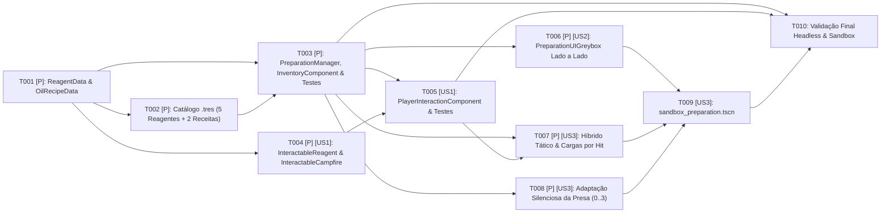

# ✅ Tarefas & Análise Cruzada: Sistema de Preparação, Coleta de Reagentes e Alquimia de Óleos (Greybox)

**Diretório da Feature**: `specs/004-preparation-crafting`  
**Pré-requisitos**: `spec.md` (🔒 Portão 1 Aprovado) e `plan.md` (Constitution Check Aprovado)  
**Status no Ciclo SDD**: `[x] 5. Tarefas Definidas` | `[x] 6. Análise Cruzada (🔒 Portão 2 Pronto para Aprovação)` | `[ ] 7. Implementado`

---

## Formato das Tarefas: `[ID] [P?] [Story] Descrição com caminho exato + Critério de Conclusão`

- **`[P]`**: Pode ser executada em paralelo (arquivos distintos, sem dependência pendente).
- **`[US#]`**: História de usuário / Requisito Funcional de origem (`RF-XXX`, `EC-XXX`).
- **Critério de Conclusão (DoD)** e **Dependências** explícitos em cada tarefa.
- **Distribuição em Issues**: Sincronizado com o GitHub (`Varto-Kai/huntress`) via `/speckit-github-taskstoissues`.

---

## Fase 1: Fundacional (Custom Resources, Catálogo `.tres` de Reagentes/Receitas e `PreparationManager`)

**⚠️ CRÍTICO**: Deve estar concluída antes da integração nos nós de mundo, combate e interface da Fogueira.

- [ ] T001 [P] Implementar os `Custom Resources` `ReagentData` (`src/data/reagent_data.gd`) e `OilRecipeData` (`src/data/oil_recipe_data.gd`)
  - **Origem**: `RF-001`, `RF-008`, `EC-005` | **Depende de**: Nenhuma | **Issue**: `#12`
  - **Critério de Conclusão (DoD)**: Classes `Resource` 100% tipadas com `@export` (`reagent_id`, `max_stack`, `result_oil`, `required_reagent_ids`, `required_reagent_amounts`, `charges_per_craft = 8`) e validação defensiva `sanitize()`.
- [ ] T002 [P] Criar catálogo `.tres` de reagentes e receitas em `src/data/` (5 `ReagentData` e 2 `OilRecipeData`) e sincronizar textos de fórmula nas pistas `.tres`
  - **Origem**: `RF-001`, `RF-009`, `data-model.md` (§2) | **Depende de**: `T001` | **Issue**: `#13`
  - **Critério de Conclusão (DoD)**: Recursos `reagent_alchemical_base.tres`, `reagent_corrosive_bile.tres`, `reagent_sulfur_powder.tres`, `reagent_flammable_tallow.tres`, `reagent_dry_ember.tres`, `recipe_vitriol_acid.tres` e `recipe_ignis_oil.tres` criados e válidos no Godot 4.7.2.
- [ ] T003 [P] Implementar o motor puro `PreparationManager` (`src/systems/preparation_manager.gd`), o componente `InventoryComponent` (`src/components/inventory_component.gd`) e a suíte unitária `tests/unit/test_preparation_manager.gd`
  - **Origem**: `RF-002`, `RF-005`, `RF-008`, `EC-001`, `EC-004`, `EC-005`, `SC-001` | **Depende de**: `T001`, `T002` | **Issue**: `#14`
  - **Critério de Conclusão (DoD)**: Acúmulo de reagentes respeitando `max_stack`, síntese atômica de receitas (`EC-001`), débito de `1` carga por acerto conectado revertendo para `NONE` ao zerar (`Q2`, `EC-004`), cálculo de Adaptação Silenciosa (`region_alert_level: 0..3`, `Q4`) e cobertura $\ge 90\%$ em `test_preparation_manager.gd`.

---

## Fase 2: User Story 1 - Coleta de Reagentes Alquímicos no Mapa e Estação de Fogueira (Prioridade: P1) 🎯 MVP

**Objetivo**: Permitir que a Caçadora colete reagentes no chão (`InteractableReagent`), interaja com a Fogueira (`InteractableCampfire`) e reabasteça a zona ao descansar.  
**Teste Independente**: Coletar reagentes no mapa, verificar o estado esgotado, descansar na fogueira e validar o respawn dos nós.

- [ ] T004 [P] [US1] Implementar as entidades de mundo `InteractableReagent` (`src/entities/world/interactable_reagent.gd` e `.tscn`) e `InteractableCampfire` (`src/entities/world/interactable_campfire.gd` e `.tscn`)
  - **Origem**: `RF-003`, `RF-008`, `EC-002` | **Depende de**: `T001` | **Issue**: `#15`
  - **Critério de Conclusão (DoD)**: `Area2D` na camada 8 (`Interactables`) com visual *Greybox* configurável via `@export`, estado coletado/esgotado com método `respawn_reagent()` em `InteractableReagent` e gatilho de bancada em `InteractableCampfire`.
- [ ] T005 [US1] Expandir `PlayerInteractionComponent` (`src/components/player_interaction_component.gd`) para selecionar por distância entre pistas, reagentes e fogueira, e criar a suíte `tests/unit/test_reagent_and_campfire.gd`
  - **Origem**: `RF-003`, `EC-001`, `EC-002`, `SC-002` | **Depende de**: `T003`, `T004` | **Issue**: `#16`
  - **Critério de Conclusão (DoD)**: Coleta de `InteractableReagent` e abertura de `InteractableCampfire` via `signals` desacoplados sem quebrar os testes existentes de `InteractableClue` da `SPEC-003`.

---

## Fase 3: User Story 2 & 3 - Bancada Lado a Lado ao Grimório, Híbrido Tático de Combate e Adaptação Silenciosa (Prioridade: P2/P3)

**Objetivo**: Acoplar a Bancada de Alquimia & Loadout ao lado direito do Grimório (`Q3`), integrar o consumo de cargas por golpe (`Q2`) e aplicar a Adaptação Silenciosa da Presa (`Q4`) nos monstros e na `sandbox_preparation.tscn`.  
**Teste Independente**: Abrir `res://tests/sandboxes/sandbox_preparation.tscn` e completar o fluxo *Investigar $\rightarrow$ Coletar Reagentes $\rightarrow$ Abrir Fogueira Lado a Lado $\rightarrow$ Sintetizar Óleo $\rightarrow$ Lutar e Testar Descanso/Adaptação Silenciosa* em menos de 60 segundos.

- [ ] T006 [P] [US2] Implementar `PreparationUIGreybox` (`src/ui/preparation_ui_greybox.gd`) e modo acoplado Lado a Lado em `GrimoireUIGreybox` (`src/ui/grimoire_ui_greybox.gd`)
  - **Origem**: `RF-006`, `RF-007`, `RF-008`, `EC-003`, `Q3`, `Q4` | **Depende de**: `T003` | **Issue**: `#17`
  - **Critério de Conclusão (DoD)**: Ao interagir com a Fogueira, o Grimório abre à esquerda e a Bancada abre à direita; a Bancada exibe reagentes, receitas neutras (sem sugerir nem dar spoiler da receita correta/falsa — `Q3`), seletor de Postura/Óleo com cargas e botão `[Descansar na Fogueira]` (sem exibir avisos de nível de alerta — `Q4`), fechando automaticamente ao sofrer dano (`EC-003`).
- [ ] T007 [P] [US3] Integrar `InventoryComponent` em `CombatStyleComponent` (`src/components/combat_style_component.gd`), `Player` (`src/entities/player/player.gd` e `player.tscn`) para troca Híbrida (`Q1`) e consumo por golpe conectado (`Q2`)
  - **Origem**: `RF-004`, `RF-005`, `EC-004`, `EC-006` | **Depende de**: `T003`, `T005` | **Issue**: `#18`
  - **Critério de Conclusão (DoD)**: Quando `allow_free_debug_switching == false`, Posturas (`1`/`2`) trocam livremente, Óleos (`Q`) exigem cargas sintetizadas no `InventoryComponent`, e `HitboxComponent.hit_landed` debita `1` carga (revertendo para `NONE` ao chegar a `0`); quando `true`, preserva 100% do comportamento legado (`EC-006`).
- [ ] T008 [P] [US3] Integrar a Adaptação Silenciosa da Presa (`region_alert_level: 0..3`) em `DamageResolver` (`src/systems/damage_resolver.gd`), `CombatDummy` (`src/entities/monsters/combat_dummy.gd`) e `HazardPulseEmitter` (`src/entities/world/hazard_pulse_emitter.gd`)
  - **Origem**: `RF-003`, `RF-008`, `EC-002`, `Q4` (`/grill-me`) | **Depende de**: `T003` | **Issue**: `#19`
  - **Critério de Conclusão (DoD)**: A cada descanso na Fogueira, os monstros sofrem respawn e aumentam silenciosamente seu `max_stagger`, aceleram a cadência de pulso hostil e reduzem o dano/Stagger recebidos de ataques Neutros/Resistidos, mantendo 100% de eficiência quando atingidos pela Fraqueza Verdadeira (Postura Certa + Óleo Certo).
- [ ] T009 [US3] Criar a cena `tests/sandboxes/sandbox_preparation.tscn` e script `tests/sandboxes/sandbox_preparation.gd`
  - **Origem**: `RF-009`, `SC-003` | **Depende de**: `T006`, `T007`, `T008` | **Issue**: `#20`
  - **Critério de Conclusão (DoD)**: Arena Greybox completa contendo a Caçadora (`allow_free_debug_switching = false`), Fogueira Central (`InteractableCampfire`), nós de reagentes contados (`InteractableReagent`), pistas autênticas e falsas (`InteractableClue`), 2 alvos `CombatDummy`, `HazardPulseEmitter` adaptativo e interfaces Lado a Lado (`GrimoireUIGreybox` + `PreparationUIGreybox`).

---

## Fase 4: Polimento, Parametrização e Validação Final

- [ ] T010 Atualizar `tests/unit/run_tests.gd` e executar a suíte completa headless (`SPEC-001` + `SPEC-002` + `SPEC-003` + `SPEC-004`) e validar `sandbox_preparation.tscn` no Godot 4.7.2
  - **Origem**: `SC-001`, `SC-002`, `SC-003` | **Depende de**: `T003`, `T005`, `T009` | **Issue**: `#21`
  - **Critério de Conclusão (DoD)**: 100% dos testes unitários e de componente passando em modo headless no Godot 4.7.2, zero regressão nas sandboxes anteriores e todos os scripts dentro das diretrizes da Constituição.

---

## Dependências & Execução Paralela

---

## 🔒 PORTÃO DE QUALIDADE 2: Análise Cruzada (`/speckit-analyze`)

> *Preenchido na Etapa 6 antes de qualquer execução do `/speckit-implement`. O Desenvolvedor verifica pessoalmente este relatório.*

### 1. Matriz de Rastreabilidade (`Constituição <-> Spec <-> Plano <-> Tarefas`)

| Requisito / Caso de Borda (`spec.md`) | Seção do Plano (`plan.md`) | Tarefa(s) (`tasks.md`) | Regra Constitucional | Status |
| :--- | :--- | :--- | :--- | :---: |
| `RF-001` (`ReagentData` e `OilRecipeData` tipados + catálogo `.tres`) | Seção 2.2, `data-model.md` §1-2 | `T001`, `T002` | Seção 3.2 (`Custom Resources`) | ✅ Coberto |
| `RF-002` (`PreparationManager` e `InventoryComponent` atômicos) | Seção 2.2, `DT-01` | `T003`, `T010` | Seção 1.2.1 (Component Pattern) | ✅ Coberto |
| `RF-003` (`InteractableReagent`, `InteractableCampfire` e Descanso na Fogueira via `signals`) | Seção 2.1, Seção 3.2 | `T004`, `T005`, `T008` | Seção 1.2.3 (*Signals First*) | ✅ Coberto |
| `RF-004` (Híbrido Tático `Q1`: Posturas livres em campo, Alquimia na Fogueira) | `research.md` §1, `DT-04` | `T006`, `T007` | Seção 1.1 (Modularidade) | ✅ Coberto |
| `RF-005` (Cargas por Golpe Conectado `Q2`: `8` cargas por síntese, débito em `hit_landed`) | `research.md` §2, Seção 3.3 | `T001`, `T003`, `T007`, `T010` | Seção 2.2 ($\ge 90\%$ Cobertura Lógica) | ✅ Coberto |
| `RF-006` (Bancada anexada Lado a Lado ao Grimório `Q3` + Zero Spoiler de receita) | `research.md` §3, `DT-02` | `T006`, `T009` | Seção 2.1 (*Placeholder First*) | ✅ Coberto |
| `RF-007` (`PreparationUIGreybox` com reagentes, síntese, loadout e botão Descansar) | Seção 2.2, `DT-02` | `T006`, `T009` | Seção 1.2.3 (Feedback por Sinais) | ✅ Coberto |
| `RF-008` (Adaptação Silenciosa da Presa `0..3` `Q4` + parâmetros `@export`) | `data-model.md` §3, Seção 3.3, `DT-03` | `T001`, `T003`, `T008` | Seção 1.2.4 (Zero Números Mágicos) | ✅ Coberto |
| `RF-009` (Cena `sandbox_preparation.tscn` integrando Investigação + Alquimia + Combate) | Seção 2.1, Seção 6 | `T009`, `T010` | Seção 2.3 (Cena Sandbox Obrigatória) | ✅ Coberto |
| `EC-001` (Rejeição atômica ao tentar sintetizar sem reagentes suficientes) | Seção 2.2, `DT-01` | `T003`, `T006`, `T010` | Seção 3.3 (Validação Defensiva) | ✅ Coberto |
| `EC-002` (Recuperação de erro via Descanso na Fogueira + Respawn + Adaptação Silenciosa) | `research.md` §4, `DT-03` | `T004`, `T008`, `T009` | Seção 2.2 (Testes de Borda) | ✅ Coberto |
| `EC-003` (Fechamento automático do Grimório + Bancada ao sofrer dano) | Seção 2.2 | `T006`, `T009` | Seção 3.3 (Transições Fail-Safe) | ✅ Coberto |
| `EC-004` (Bloqueio de óleo com `0` cargas e reversão automática para `NONE` ao esgotar) | `research.md` §2 | `T003`, `T007`, `T010` | Seção 2.2 (Testes Unitários) | ✅ Coberto |
| `EC-005` (Sanitização contra `ReagentData` / `OilRecipeData` nulos ou quantidades $\le 0$) | Seção 2.2 | `T001`, `T003` | Seção 3.3 (Validação Defensiva) | ✅ Coberto |
| `EC-006` (Preservação das cenas `sandbox_combat` e `sandbox_investigation` via `allow_free_debug_switching`) | `research.md` §1, `DT-04` | `T007`, `T010` | Seção 2.2 (Zero Regressão) | ✅ Coberto |

### 2. Auditoria de Consistência e Anomalias
- **Contradições entre `Constituição <-> Spec <-> Plano <-> Tarefas`**: **Nenhuma detectada** (`0` conflitos).
- **Requisitos Órfãos (Requisito na Spec sem Tarefa correspondente)**: **Nenhum detectado** (`100%` dos requisitos `RF-001`..`RF-009`, `EC-001`..`EC-006` e `SC-001`..`SC-003` mapeados).
- **Tarefas sem Origem (Tarefa que não deriva de nenhum Requisito da Spec)**: **Nenhuma detectada** (`T001` a `T010` possuem rastreabilidade direta).

### 3. Checklist de Qualidade por Tipo de Risco

| Categoria de Risco | Verificação Realizada | Mitigação nas Tarefas | Status |
| :--- | :--- | :--- | :---: |
| **1. Risco Arquitetural / Acoplamento** | Duplicação da UI do Grimório ou acoplamento direto entre Bancada e nós do mapa? | Modo acoplado `set_docked_mode(true)` em `GrimoireUIGreybox` lado a lado com `PreparationUIGreybox` + sinais em `InventoryComponent`. | ✅ |
| **2. Risco de Game Feel / Performance** | Golpes no vazio gastando cargas de Óleo ou travando troca de Postura em combate? | Consumo de carga estritamente em `HitboxComponent.hit_landed` (`Q2`) e troca livre de Posturas (`1`/`2`) preservada (`Q1`). | ✅ |
| **3. Risco de Dados / Estado** | Regressão nas cenas Sandbox anteriores (`SPEC-002` / `SPEC-003`) ou perda parcial de reagentes? | Transação atômica em `PreparationManager.craft_oil` (`EC-001`) e flag `@export var allow_free_debug_switching: bool = true` por padrão (`EC-006`). | ✅ |
| **4. Risco de Escopo / Greyboxing** | Vazamento de aviso de Nível de Alerta na UI ou tentativa de implementar o puzzle *Potion Permit* agora? | Adaptação da Presa ocorre 100% silenciosa nos bastidores (`Q4`) e referência ao *Potion Permit* isolada no GDD e nos Non-Goals (`Q3`). | ✅ |

### 4. Assinatura Pessoal do Desenvolvedor (Portão 2)
- [x] Matriz de Rastreabilidade sem contradições, sem requisitos órfãos e sem tarefas sem origem.
- [x] Checklist de Qualidade por Tipo de Risco 100% validado.
- [x] Tarefas prontas/distribuídas em Issues no GitHub (`Varto-Kai/huntress` — Issues `#12` a `#21`).
- [x] **Verificado e aprovado pessoalmente pelo Desenvolvedor para Implementação em:** `2026-10-21`
